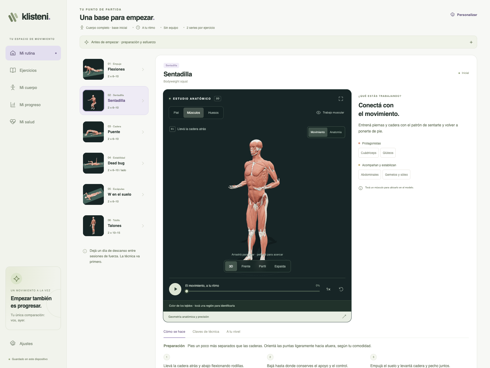
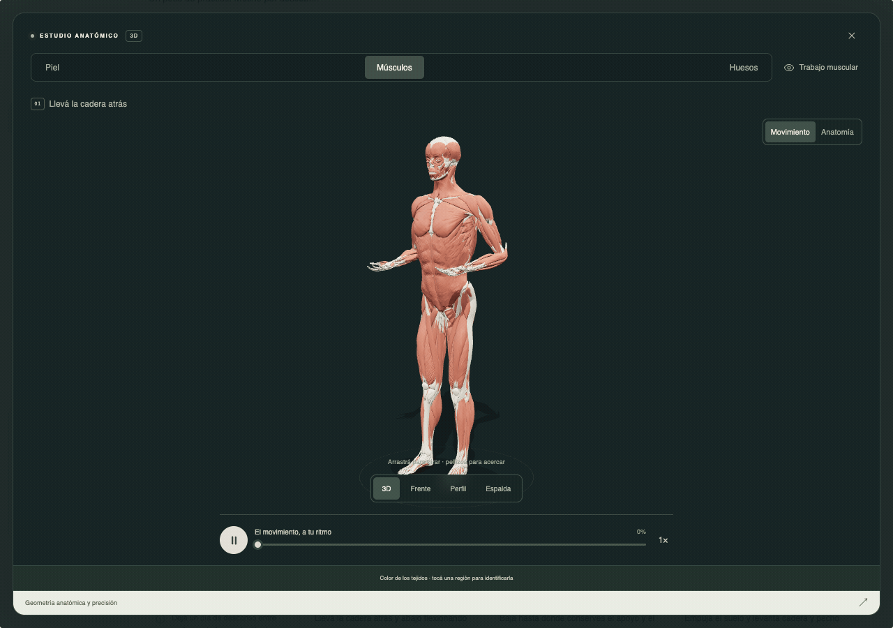
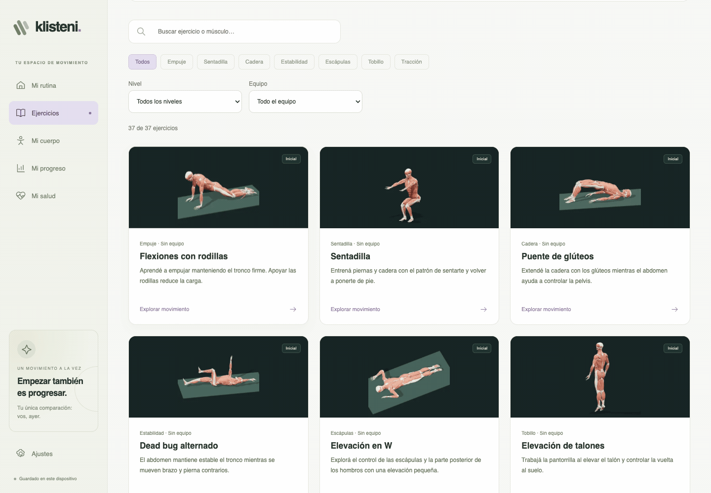
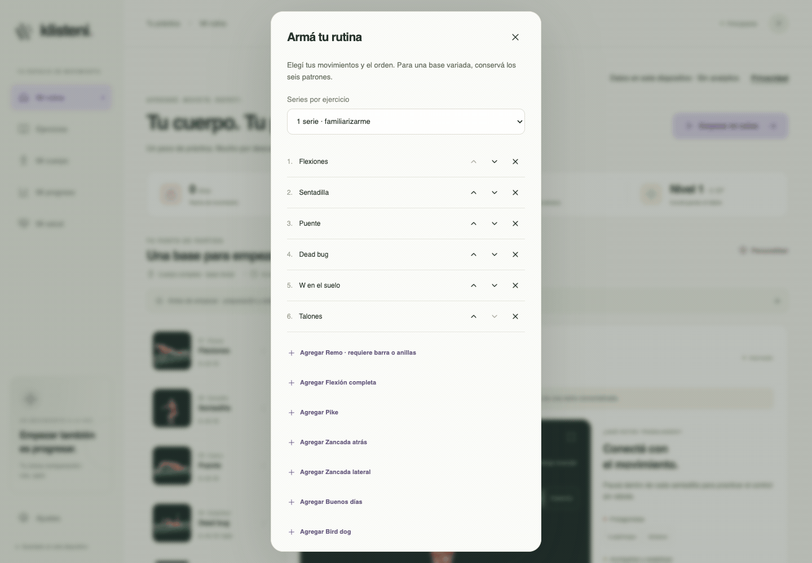
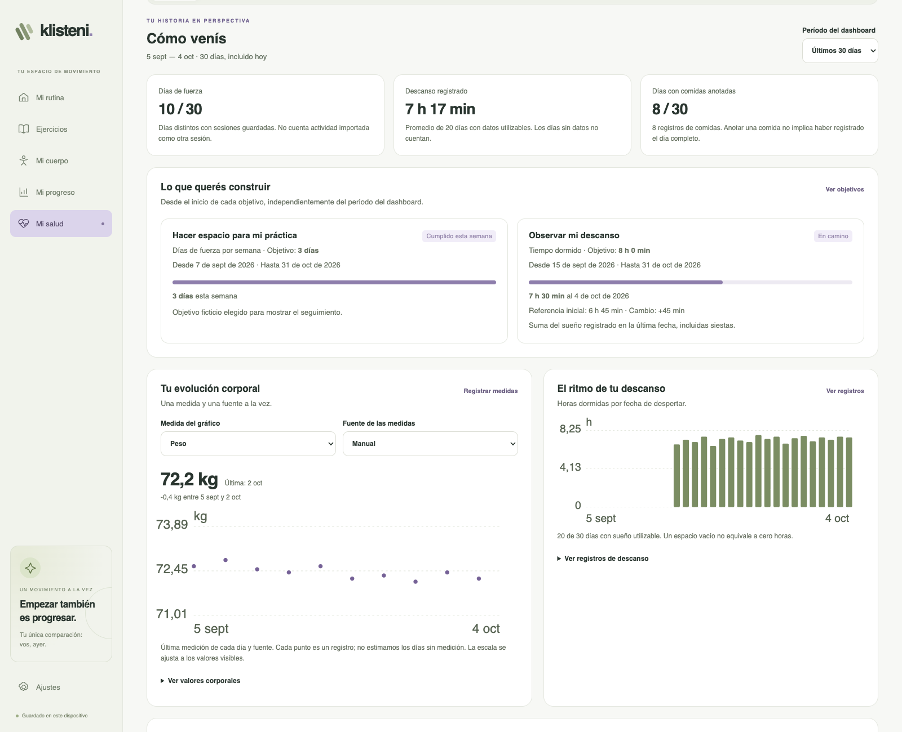
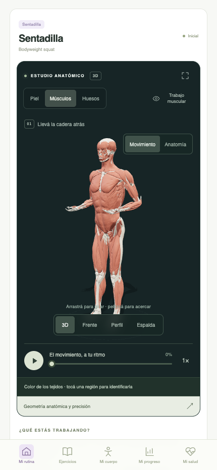
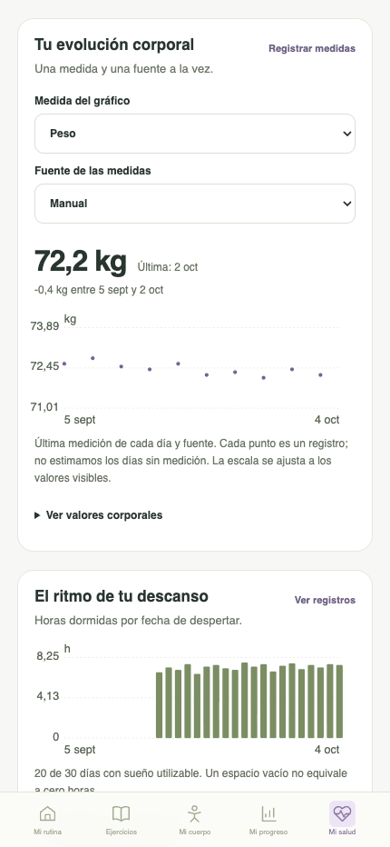

# Klisteni

**Learn the movement. Understand your body. Build the habit.**

An educational calisthenics app that puts the explanation beside the exercise.
Explore a moving anatomical model, discover what each movement asks of your
body, shape a routine and keep a record of your practice. Start with your body
weight, a browser and a little curiosity.

**37 exercises & variants · 35 without equipment · Interactive 3D anatomy · Free local mode**

[Take a tour](#take-a-tour) · [Run locally](#run-locally) · [Public demo and instance modes](docs/public-demo.md) · [Documentation](docs/README.md)



*Designed for phone and desktop. The application is currently in Spanish; this
README is in English. The tour shows the public demo build, with fictional
records in the health and progress examples.*

## Take a tour

### See the movement from the inside

A repetition makes more sense when you can slow it down and look around it.
Pause the demonstration, scrub through its cycle and compare **3D, front, side
and back** views. Switch between **skin, muscles and bones**. Highlight the
muscle groups involved and select a structure
to see its name.



Open **Mi cuerpo** to explore the atlas in its standing reference pose. Return
to an exercise to connect those structures to a movement, with **how-to steps,
technique cues, easier and harder variations, and references** beside the model.

The anatomy comes from **Z-Anatomy / BodyParts3D**, with **955 meshes** sharing
the same coordinate system. The animated poses are educational illustrations:
colors describe the catalogue's muscle classification, not measured activation,
and the app does not assess your form.
[Anatomy sources, adaptations and limits →](docs/anatomy-model-sources.md)

### Find your next movement

Browse **37 exercises and variants** across **7 movement patterns**. Search by
Spanish or English name, or by muscle; combine movement, difficulty and equipment
filters to narrow the library. Each card previews the same anatomical model and
movement used in the full viewer.



Squats, push-ups, lunges, hip hinges, bridges, trunk control, calf raises and
W/T/Y movements sit alongside two bar-or-ring rowing variations. **35 exercises
need no equipment.** Equipment requirements stay visible when adding movements
to a routine.

Each exercise also explains **how it fits into a routine**: support points,
coordination demands, counting per side, alternatives and reviewed progressions.
That metadata is available today; automatic weekly programme generation is a
future step. [Catalogue and educational criteria →](docs/exercise-sources.md) ·
[Planning metadata →](docs/exercise-planning.md)

### Turn a little practice into a visible habit

**Mi rutina** starts with six equipment-free movements. Use **Personalizar** to
add, remove and reorder exercises, and choose one to three sets. Start a session,
record the repetitions you actually complete, then **save the finished workout**.
Walks, runs, bike rides and other aerobic activity have their own log.



**Mi progreso** brings together the weekly view, activity history and XP.
The history starts empty: watching the animation does not count as training.
Earn **10 XP per recorded strength set** and **1 XP per recorded cardio minute**,
with a level every 100 XP. These are habit-building counters, not fitness scores
or calorie estimates. [See the progress view →](docs/media/progress.png)

Accounts add named routines, a tracking time zone and a weekly strength plan.
The plan's consistency metric counts **weeks meeting your chosen number of strength-training days**;
rest days do not break it, and moving a session within the week is fine. The
local activity streak is a separate metric.

<details>
<summary><strong>The six-movement starting point</strong></summary>

| Movement | What it introduces |
| --- | --- |
| Knee push-up | Pushing and trunk control |
| Squat | Coordinating hips and knees |
| Glute bridge | Hip extension |
| Alternating dead bug | Trunk control with moving limbs |
| Prone W raise | Light scapular control |
| Calf raise | Ankle and calf control |

The default is two sets and a two-session weekly goal, both editable. Read the
preparation notes and each exercise's technique cues in the app.

**Loaded pulling needs equipment.** A prone W does not replace a row or pull-up
for the back and biceps. The two rowing variations require a suitable bar or
rings and are outside the starter routine.

</details>

### Put your practice in context

**Mi salud** brings body measurements, sleep, activity, meals, supplements and
dated personal goals into the same workspace. Record observations manually or
preview a **normalized Klisteni JSON** import before confirming it. Records keep
their declared source and device, and can be edited, deleted and exported.



Choose **7, 30 or 90 days**, a body measurement and its source. Explore observed
trends, sleep coverage and days with recorded strength practice. Missing values
stay missing; separate units and devices are not silently combined. Expand the
data tables to inspect the values behind the charts.

**Automatic watch synchronization is still planned.** Samsung Health / Health
Connect need an Android bridge; Google Health needs a separate connector and
provider access. The importer accepts Klisteni's documented JSON format, not raw
Samsung CSV/ZIP exports. [Health dashboard →](docs/health-dashboard.md) ·
[Import format →](docs/health-import.md) · [Integration status →](docs/health-integrations.md) ·
[Watch the health tour →](docs/media/health-tour.gif)

### Keep it with you

<table>
  <tr>
    <td align="center"></td>
    <td align="center"></td>
  </tr>
  <tr>
    <td align="center"><strong>Your movement workspace</strong></td>
    <td align="center"><strong>Your observations over time</strong></td>
  </tr>
</table>

The layout adapts to a phone. Text guidance remains available if WebGL cannot
start, and reduced-motion preferences stop animated previews. This is a web app;
it is not yet a PWA and does not guarantee offline availability.

## Your browser first. An account when you need one.

The local experience is free and needs no account. An invited account adds
server persistence and access from another device in an explicitly configured
instance. The default public build is a complete local demo: it contains no
login, paywall, account client or analytics, and makes no backend requests.

| Capability | Free local mode | Invited account with active cloud access |
| --- | --- | --- |
| Catalogue, anatomy and exercise guidance | Yes | Yes |
| Customize a routine and log practice | In this browser | Saved to your account |
| Health records, goals and dashboard | In this browser | Saved to your account |
| Export / import your data | Yes | Yes |
| Named routines, weekly plan and tracking time zone | — | Yes |
| Sync between devices | — | API + PostgreSQL |

Trial invitations provide **15 days of cloud access** from registration.
Administrators can issue personal or shareable invitations and grant lifetime
access. When cloud access expires, the account keeps reading, export and record
deletion available; new cloud writes need renewed access. Free local use remains
available. **Mercado Pago billing is development-only and disabled by default**;
production charging is not implemented.

These are repository capabilities. Account availability on a hosted release
requires the API, database and deployment to be configured and verified.
[Accounts and recovery →](docs/accounts.md) · [Invitations and subscriptions →](docs/subscriptions.md)

### Data you can take with you

- **Local means this browser and origin.** Export a JSON copy before clearing
  storage or changing devices. Local mode does not coordinate writes across tabs.
- **Import is deliberate.** Signing in does not automatically upload the practice
  found on a shared device. Personal v2 exports include settings and health;
  legacy v1 training-history imports remain supported.
- **Saved means confirmed.** Account synchronization distinguishes pending,
  confirmed and failed writes, and detects conflicting settings changes.
- **Finish before you leave.** An active workout lives in memory until you save
  it. Reloading discards its unfinished sets.
- **The public demo has no analytics.** An operator can configure optional
  Umami in an instance; it loads after consent and sends a sanitized site visit,
  without routines, health values, notes, email or account IDs. Consent can be
  refused or withdrawn from privacy preferences.

Fonts come from your device. Exercise references open external websites only
when selected. The demo's `/privacy` page describes local storage; an instance
adds its operator's public profile and disclosures from external configuration.
[Modes, privacy and the public profile →](docs/public-demo.md)

## Run locally

You need **Node.js 24+**, **pnpm 12.7.0** and a modern browser. The 3D viewer uses
**WebGL 2**. Models and exercise previews are already included.

```sh
pnpm install --frozen-lockfile
pnpm dev
```

Open the URL printed by Vite, normally [localhost:5173](http://localhost:5173).
The default `VITE_APP_MODE=demo` needs **no API key, database, operator profile
or Blender installation**. Models and previews are ready to use.

For accounts, set `VITE_APP_MODE=instance`, provide
`KLISTENI_PUBLIC_PROFILE_FILE` with your operator's public disclosures, and follow
the [API and PostgreSQL setup](docs/accounts.md#local-instance-with-disposable-configuration). The profile is
public build data, never a place for credentials. Real deployment configuration
belongs outside this repository. [Instance setup →](docs/public-demo.md)

For UI iteration with the full local API, database and a fictional administrator,
run `node scripts/dev-ui-instance.mjs`. [Local UI workspace →](docs/ui-iteration.md)

```sh
# Build all packages, then serve the web bundle locally
pnpm build
pnpm --filter @klisteniapp/web preview --host 127.0.0.1
```

The web output is `apps/web/dist`. Serve the demo with any static host that
supports SPA fallback to `index.html`, including `/privacy`. The optional server
instance has separate web/API images and generic deployment examples.
[Deployment and rollback →](docs/deployment.md)

## Built to keep the explanation close to the code

Klisteni uses a **pnpm / Turborepo** monorepo with **React 19, TypeScript, Vite,
Three.js, React Three Fiber, Drei,
Zustand and Zod**. The API uses **Better Auth and PostgreSQL**.

| Location | Responsibility |
| --- | --- |
| [`apps/web`](apps/web) | Responsive UI, 3D viewer, forms, health dashboard and browser state |
| [`apps/api`](apps/api) | Accounts, invitations, access rules, personal data and development billing |
| [`packages/scene-schema`](packages/scene-schema) | Shared validated contracts for exercises, records and plans |
| [`packages/geometry`](packages/geometry) | Exercise poses and kinematics, independent of React |
| [`apps/web/public/models`](apps/web/public/models) | Anatomical GLB, joint landmarks and provenance |
| [`assets/blender`](assets/blender) | Editable anatomy scene and optimization report |
| [`scripts`](scripts) | Anatomy builds, validation and reproducible media capture |

Blender prepares the anatomy assets; TypeScript drives the poses in the browser.
The `.blend` source, GLB and manifests stay together. The same `ExerciseStage`
renders the live viewer and the catalogue previews, with source hashes to detect
stale images. [Architecture →](docs/architecture.md)

### Reproduce the visuals

```sh
# Catalogue previews: Playwright Chromium + cwebp / img2webp
pnpm previews:generate
pnpm previews:generate --exercise squat --gif  # Also requires FFmpeg
pnpm previews:check

# README screenshots and GIFs: Playwright Chromium + cwebp + FFmpeg
node scripts/capture-readme.mjs
node scripts/capture-readme-health.mjs
node scripts/capture-readme.mjs --check
node scripts/capture-readme-health.mjs --check
```

The README capture scripts explicitly select demo mode and use isolated browser
contexts and local servers. `--mode instance` instead uses the checked-in
example public profile for an anonymous instance preview; it never loads an
operator's private profile. The manifests record which mode was captured.
Health and progress captures use schema-validated fictional fixtures, never
personal account data. [README media, reproduction and attribution →](docs/readme-media.md) ·
[Exercise preview pipeline →](docs/exercise-previews.md)

### Check a change

```sh
pnpm check            # Lint, types, domain tests, preview hashes and build
pnpm test:e2e         # Public desktop/mobile browser flows
pnpm test:analytics   # Isolated consent and privacy flows
pnpm check:all        # All three commands above

# Account/database checks require a disposable TEST_DATABASE_URL
pnpm test:api
pnpm test:accounts
```

Install Chromium once with
`pnpm --filter @klisteniapp/web exec playwright install chromium`.
The public browser suite uses `127.0.0.1:4174`; run build-owning browser suites
sequentially. Database tests skipped without `TEST_DATABASE_URL` do not validate
PostgreSQL behavior. [Account test setup →](docs/accounts.md#verificación-reproducible)

For anatomy changes, run `node scripts/validate-anatomy.mjs` and visually review
poses from multiple angles. Rebuilding the source asset uses
`node scripts/build-anatomy.mjs` and requires Blender. Passing tests does not
establish biomechanical accuracy.

## What's next

Professional review of movement trajectories, recovery of unfinished sessions,
weekly programme generation, automatic health connectors, more languages and
installable/offline support are future work. The current focus is a complete,
inspectable loop: **see → understand → practice → record**.

## Credits and licenses

The original application code is **[MIT](LICENSE)**. Anatomical assets and their
derived renders use **CC BY-SA 4.0**, with credits to **BodyParts3D — The Database
Center for Life Science**, **Z-Anatomy — Gauthier Kervyn and contributors**, and
**Lluís Vinent Juanico** for the source FBX distribution. Code licensing does not
replace the anatomy license.

[License scope and third-party notices](NOTICE) · [Full anatomy attribution and license](apps/web/public/models/NOTICE.md) ·
[Preview attribution](apps/web/public/previews/NOTICE.md) ·
[README media attribution](docs/media/NOTICE.md)
