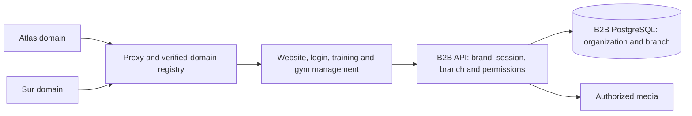
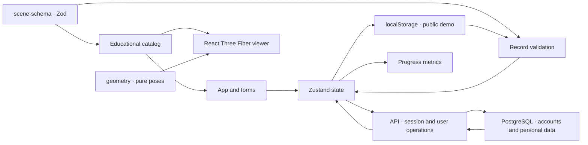

<a id="arquitectura-de-klisteni"></a>

# Klisteni architecture

Klisteni separates verifiable data, geometry and presentation. B2C serves static
catalog/viewer; API adds managed accounts/personal PostgreSQL persistence. B2B
combines website/training/gym management, independent API/PostgreSQL/media.
Shared catalog/geometry/view packages, no shared identities/data. Personal demo
available without login. Code alone establishes no deployment. Earlier planned
states/version limits below are retained from the source description; later
[white-label validation](b2b-white-label-validation.md)/QA evidence takes precedence.

<a id="mapa-del-repositorio"></a>

## Repository map

Four apps: `b2c-web`, `b2c-api`, `b2b-web`, `b2b-api`. B2B has one entry/Vite/build.
`ApplicationProvider` owns session/brand/explicit branch-role selection; domain
`features/` compose routes. Member: `/app/routines`, `/app/catalog`, `/app/history`.
Professional: `/manage/people`, `/manage/programs`, `/manage/catalog`,
`/manage/equipment`, others. Internal navigation retains context/back-forward/reload.
`/backoffice` subroutes compatibility aliases to `/manage`. Public entry requests
no account data. Account/branch/role change scopes client/cancels stale requests/
isolates drafts. API owns sessions/effective authorization.

Future owner `backoffice`: insights/general B2C-B2B administration, separate from
gym staff management. Console/Odoo integration pending; define commercial-data
ownership/synchronization without duplicate responsibility.

```text
apps/b2c-web/
  src/
    App.tsx                     Navigation, selection and screen composition
    components/
      AnatomyViewer.tsx         R3F viewer, layers, controls and expanded mode
      AnatomicalModel.tsx       B2C adapter of shared model
      AnatomyStudio.tsx         Shared studio reexport
      Forms.tsx                 Routine, session, cardio, settings and JSON transfer
      Progress.tsx              History, week and gamification
      Modal.tsx                 Dialog container
    data/exercises.ts           Compatible shared-catalog reexport
    lib/
      store.ts                  Zustand, local demo and account synchronization
      account-api.ts            Same-origin HTTP client, sessions and operations
      progress.ts               Pure dates, validation and metrics
  test/                         Application domain tests
  e2e/                          Playwright browser flows
apps/b2c-api/                    Better Auth, sessions, PostgreSQL operations and CLI
  src/                          Server, data repository, migrations and operator
  tests/                        Contracts and test-PostgreSQL acceptance
apps/b2b-web/src/                Public website, QR and member training
  app/                          Shared context, navigation and permission-based views
  features/                     Catalog, people, routines, equipment, media, website and organization
  shared/                       Supporting UI and editor recovery
apps/b2b-api/                    Independent B2B API, identities, PostgreSQL and media
assets/blender/                 Editable anatomical scene and optimization report
scripts/blender/                FBX import, inspection and conversion
packages/
  b2b-contracts/src/             Domain B2B schemas and types
  b2b-domain/src/                Pure prescription/execution rules
  b2b-client/src/                HTTP, errors and cancellation without React
  b2b-react/src/                 Account/organization-isolated sessions and loads
  b2b-ui/src/                    Controls/content with injected actions
  catalog-base/src/              Shared catalog, planning and sources
  anatomy-viewer/src/            Rig, layers, studio and viewers without product state
  model-assets/public/           GLB, landmarks, previews, provenance and licenses
  scene-schema/src/index.ts      Zod contracts and inferred types
  geometry/src/index.ts          Poses, joints and kinematics
docs/
  exercise-sources.md            Educational decisions' provenance and limits
  anatomy-model-sources.md       Mesh provenance, licensing and limits
```

`scene-schema` retains reference-architecture name; contracts only, no geometry/
storage. `geometry` computes coordinates; `anatomy-viewer` prepares/renders; apps
own navigation/preferences/permissions. Shared packages must not import B2C components.

[White-label/gym management](b2b.md) documents B2B isolation/deployments.
`catalog-base` preserves original IDs. `anatomy-viewer` receives preferences/asset
resolution as props; B2C adapters keep store/i18n in `apps/b2c-web`. `model-assets`
Vite plugin serves/copies resources to each build without another app's HTTP origin.

<a id="prescripción-ejecución-y-medios-b2b"></a>

## B2B prescriptions, execution and media

Backend derives organization/permissions from session/membership; writes require
origin/account guard. `b2b-contracts` formats, `b2b-domain` pure rules, API authorization/
transactions. Public client/hooks/UI entrypoints; `pnpm check:b2b:boundaries` dependencies/cycles.

Publishing creates immutable routine version. Assignment snapshots exercise/model;
catalog edits do not change prescription. Set uses reps/time, optional load/target
RPE; execution records declared quantity/effort separately. Member draft recovers
on reload/retains pending submission ID. Confirmed partial/full session immutable:
same ID/content returns same record; changed content conflicts. Rest timer/voice/
visualization alone records no work.

Editor drafts isolated by account/organization; expected revisions detect conflicts.
Website publication freezes content/brand; draft save does not publish. Plan links
physical units/filters private-retired public views. Optional spatial GLB static.
Authorized clip comparison retains provenance/human assessment, no generated
animation/automatic technique approval.

Library immutable bytes in B2B volume/metadata-hashes PostgreSQL. API authorizes
membership/current publication/authorized historical snapshot before serving,
including ranges; no static public volume. Remote-reference snapshots cannot
control provider bytes. DB/media need consistent joint backup/restore.

Separate DDL migration credentials before startup; API role no DDL. Readiness checks
schema/authentication. API/B2B frontends coordinated update; older strict parsers
reject new fields even `null`. [Compatibility](b2b.md#compatibilidad-y-despliegue-de-esta-actualización),
[verified runtime](b2b-runtime-validation.md).

<a id="evolución-b2b-planificada-dominios-marcas-y-sedes"></a>

## Recorded B2B evolution plan: domains, brands and branches

Original [white-label plan](b2b-white-label.md) described next, then-unimplemented
architecture. Later validation records implementation. Shared B2B app/deployment;
verified domain determines brand before login; multiple branches from first delivery.
B2B identity may belong to several brands, sessions/operations bound to brand and
branch permissions.



Host identifies context, grants no permission. API validates membership/branch
grants/action/resource owner. Config resolves themes/modules; frontend does not
replace backend controls. Exercises/models retain reuse/provenance; physical units/
assignments/executions add branch/history. Website publication separate from active membership.

Migration creates Principal branch for existing data, adds constraints/contracts
before new flow. WL-0–WL-8 covers sessions/URLs/QR compatibility/domain operation/
two-brand-two-branch tests/coordinated recovery. Old binary without branch permissions
not safe rollback after data addition. B2C independent.

<a id="flujo-de-datos-b2c"></a>

## B2C data flow



Catalog validates `ExerciseSchema` on load; exercise/muscle types constrain IDs.
Cards include technique/variants/main-secondary muscles/references. `getExercise`
returns `undefined` for foreign ID; UI explicitly handles it. Default routine six
no-equipment movements. Row optional educational card; initial editor offers only
`equipment: 'none'`. UI/source docs explain missing loaded pulling.

<a id="modelo-de-movimiento"></a>

## Movement model

`getExercisePose(exerciseId, phase)` returns pelvis/torso tilt/bilateral arm-leg
joints. Meters, Y up/Z forward when standing. `solveLimb` two-segment inverse
kinematics preserves lengths. Poses target hands/feet; rig adapts to measured atlas
lengths/orients without scaling. Dead bug alternates diagonals; others two phases/
smooth interpolation.

Viewer lazy from `App.tsx`; R3F coordinates Three.js, Drei `OrbitControls`. Frames
update refs without rebuilding UI; visible timeline slower. Pause/scrub/slow/camera.
Geometry prepared independently: Z-Anatomy FBX skin/muscles/skeleton share coordinates.
Blender filters auxiliary structures/preserves exterior skin/reduces internal
polygons with sampled distance checks. Common global1.80 m normalization, no independent limbs.

`anatomy.glb` meshes/metadata; `anatomy-manifest.json` source commit/SHA-256/
coordinates/changes/counts. `rig-landmarks.json` selected animation joints, not
clinically validated rotation centers. `assets/blender/anatomy.blend` editable;
`optimization-report.json` meshes/exclusions. GLB not authoring replacement;
sampled optimization points do not bound entire-surface error.

Browser preserves GLB reference positions, shares animation weights across coincident
skin vertices/subdivides triangles at matching region-edge vertices. Compatible
edges, no hole filling/new body shape. Identified axillary source gaps ~0.15–2.19 mm:
neighbor weights shared without welding/hiding gaps.

Independent scapula segments/educational W retraction. Head/shoulder/pelvis/palm
supports derived from GLB surface/scene clearance, not pressure/physical contact/
measured joint centers. Scapular range an animation decision, not user measurement.
Geometry/poses combine illustratively: no forces/joint loads/activation/form
assessment. Color indicates catalog role; W/row not equivalent by back color.
Anatomical detail does not validate biomechanics.

Blender asset preparation only, not startup/web build/runtime. Generated files in
`packages/model-assets/public/models`, `/models` per app. [Attribution/CC BY-SA4.0](../packages/model-assets/public/models/NOTICE.md)
separate from code license. [Anatomical sources](anatomy-model-sources.md) retain
MRI/artistic reconstruction/precision limits.

<a id="sesiones-métricas-y-persistencia-b2c"></a>

## B2C sessions, metrics and persistence

`WorkoutSession` active state; each set records exercise/user reps, `sets: 1` that
set. Entries sum to saved session, no inferred work from 3D/open time/planned routine.
`WorkoutLog`: ID/local date/completion timestamp/duration/sets. `CardioLog`: ID/
local date/activity/minutes/optional distance. `ProgressData` `version: 1` validates
collections/numeric bounds/real dates/unique IDs before import/serialization.

Free local `klisteniapp.progress.v1`, `klisteniapp.preferences.v1`, unreadable-data
recovery. Optional health/personal v2 in `klisteniapp.personal.v2`, not automatically
merged into account. Account `PersonalData` v2: profile/timezone/stable routine IDs/
active selection/weekly plan revisions/v1 history. Reduced motion device-local.
Login never automatically imports local data.

API validates session/derives owner. Better Auth user/password-account/revocable
session/attempt-limit tables. `personal_state` settings/revision; `personal_log`
by `(user_id, id)`, deletion tombstone prevents late resurrection. Per-user serialized
PostgreSQL transactions. Independent records need no full-history overwrite;
settings expected revision/concurrent conflict.

v2 copies personal/history, legacy v1 accepted. Account import atomically merges:
same ID/content retry, different content conflict. Settings import cannot rewrite
started plans. Originals retained; explicit decision before attribution to another account.

Sync pending/saved/error; save confirmed by server response. Temporary state scoped
to account; logout/change hides prior private data. Public/local recovery independent of DB.

`computeProgress` from saved logs. `YYYY-MM-DD` calendar date, not UTC-derived.
Account tracking timezone defines today; device change leaves dates. Monday week;
calendar offsets respect23/25-hour days. Duplicate IDs/future dates no extra reward.
`computePlanProgress` counts completed planned-strength weeks, max one/day; session
movable within week. Rest preserves streak/current week retains previous consistency.
First plan may start current week, later changes next Monday; server blocks rewriting
started weeks. Cardio does not silently satisfy strength plan.

XP product rule10/set,1/cardio minute, level each100. Historical active-day metric
consecutive logged days, yesterday allowed if today empty. Rest retains XP; values
not intensity/energy/technique/automatic aerobic-guideline compliance.

<a id="límites-de-esta-versión"></a>

## Recorded version limits

- Accounts API/PostgreSQL; production activation separately verified. Demo tied to browser/origin, no automatic import.
- Active session not persisted through reload; abandonment warning/unsaved-set distinction.
- Server settings/retry conflicts; local demo no cross-tab writer coordination.
- Original description recorded Spanish UI/unconnected `i18next`/`react-i18next` shared with T3; later multilingual implementation must be assessed from its own revision.
- WebGL2 scene; text fallback. Browser tests need real-hardware visual review.
- Device fonts, no service worker/offline startup guarantee.
- Session duration elapsed time including rest, not active time/intensity.

[Accounts/operation](accounts.md): session/CLI/migration/proxy/recovery/acceptance.
Deployment examples generic; operator desired state/credentials/evidence outside public product.

<a id="cambiar-la-aplicación-sin-perder-consistencia"></a>

## Change application consistently

New exercise: ID/contract then sourced card/equipment then pose/presentation.
Review muscles/variants/range/content; bone-length test does not prove technique.
Equipped card never automatically enters no-equipment routine. Logs/XP changes in
schema/progress functions before UI. History version needs migration/export-import
tests. Avatar changes preserve catalog muscle IDs.

`pnpm check`: lint/types/tests/build. `pnpm test:e2e`: Vite4174/desktop-mobile UI.
`pnpm check:all` combines. Actual execution determines results; intended coverage
not deployment/biomechanical certification.

<a id="invitaciones-y-administración"></a>

## Invitations and administration

`account_token` hash/purpose/recipient/expiry/use/revoke. Transaction lock coordinates
bootstrap/issue/consume. Activation creates user/credential and consumes link in
same transaction; recovery invalidates sessions. Server role; admin no foreign history.
SMTP optional, mandatory STARTTLS/TLS/own secret/explicit send. SMTP acceptance
separate from link status/inbox delivery. Activation/recovery strip fragment/excluded analytics.

<a id="demo-e-instancia"></a>

## Demo and instance

Default `VITE_APP_MODE=demo`: Vite selects local store/disabled analytics, removes
account screens; historic localStorage/v1-v2 retained. No session query/account
import-delete-attribution. `VITE_APP_MODE=instance` needs
`KLISTENI_PUBLIC_PROFILE_FILE`: validated build-time text JSON/privacy without API.
Public profile not secret channel; backend separate explicit service.

Operator real configs/runbooks/evidence private; product builds without private
repo/submodule dependencies. Build cache disabled to avoid another instance's profile.

<a id="acceso-a-nube-y-facturación-de-desarrollo"></a>

## Cloud access and development billing

`account_access` separates administrator permission/cloud saving:15-day trial/
lifetime/confirmed paid period. Personal mutations enforce entitlement inside
per-user lock/transaction; reads/export/deletion remain after expiry.
`account_share_invitation` capacity/expiry registration. Subscription/provider
payment records deduplicate/recalculate refunds. Client grants no access from return query.
[Subscriptions](subscriptions.md): migration/config/tests/limits; test Mercado Pago
only/default disabled. [Health integrations](health-integrations.md): pending external requirements.
