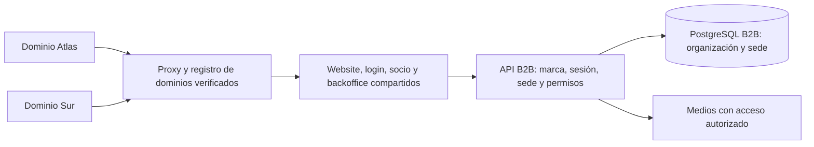

# Arquitectura de Klisteni

Klisteni separa datos comprobables, cálculo geométrico y presentación. B2C distribuye catálogo y visor como web estática; su API incorpora cuentas administradas y persistencia personal en PostgreSQL. B2B tiene website, app del socio, backoffice, API, PostgreSQL y medios independientes. Ambos productos comparten paquetes de catálogo, geometría y visualización, sin compartir identidades ni datos. La demostración personal sigue disponible sin iniciar sesión. El código por sí solo no acredita un despliegue.

## Mapa del repositorio

```text
apps/web/
  src/
    App.tsx                     Navegación, selección y composición de pantallas
    components/
      AnatomyViewer.tsx         Visor R3F, capas, controles y modo ampliado
      AnatomicalModel.tsx       Adaptador B2C del modelo compartido
      AnatomyStudio.tsx         Reexport del estudio compartido
      Forms.tsx                 Rutina, sesión, cardio, ajustes y transferencia JSON
      Progress.tsx              Historial, semana y gamificación
      Modal.tsx                 Contenedor de diálogos
    data/exercises.ts           Reexport compatible del catálogo compartido
    lib/
      store.ts                  Estado Zustand, demo local y sincronización de cuenta
      account-api.ts            Cliente HTTP del mismo origen, sesiones y operaciones
      progress.ts               Fechas, validación y métricas puras
  test/                         Pruebas del dominio de la aplicación
  e2e/                          Flujos de navegador con Playwright
apps/api/                       Better Auth, sesiones, operaciones PostgreSQL y CLI
  src/                          Servidor, repositorio de datos, migraciones y operador
  tests/                        Contratos y aceptación con PostgreSQL de prueba
apps/member-web/src/            Website público, QR y entrenamiento del socio B2B
apps/backoffice/src/            Preparación, biblioteca, prescripción y publicación
apps/b2b-api/                   API, identidades, PostgreSQL y medios propios B2B
assets/blender/                 Escena anatómica editable e informe de optimización
scripts/blender/                Importación, inspección y conversión de los FBX
packages/
  b2b-contracts/src/            Schemas y tipos B2B por dominio
  b2b-domain/src/               Reglas puras de prescripción y ejecución
  b2b-client/src/               HTTP, errores y cancelación, sin React
  b2b-react/src/                Sesión y cargas aisladas por cuenta/organización
  b2b-ui/src/                   Controles y contenido con acciones inyectadas
  catalog-base/src/             Catálogo, planificación y fuentes compartidas
  anatomy-viewer/src/           Rig, capas, estudio y viewers sin estado de producto
  model-assets/public/          GLB, landmarks, previews, procedencia y licencias
  scene-schema/src/index.ts     Contratos Zod y tipos inferidos
  geometry/src/index.ts         Poses, articulaciones y cinemática
docs/
  exercise-sources.md           Procedencia y límites de las decisiones educativas
  anatomy-model-sources.md      Procedencia, licencias y límites de las mallas
```

El paquete `scene-schema` conserva el nombre de la arquitectura de referencia para sus contratos compartidos. No contiene geometría ni acceso al almacenamiento. `geometry` calcula coordenadas; `anatomy-viewer` prepara y representa los modelos; cada aplicación decide navegación, preferencias y permisos. Ningún paquete compartido debe importar componentes de `apps/web`.

La separación B2B y sus despliegues independientes están documentados en [Marca blanca y backoffice](b2b.md). `catalog-base` conserva los IDs originales. `anatomy-viewer` recibe preferencias y resolución de assets por props; los adaptadores B2C mantienen store e i18n dentro de `apps/web`. `model-assets` sirve y copia los recursos a cada build con su plugin Vite, sin depender del origen HTTP de otra app.

## Prescripción, ejecución y medios B2B

El backend deriva organización y permisos desde la sesión y la membresía; cada escritura exige el origen y la guardia de cuenta. `b2b-contracts` define los formatos, `b2b-domain` concentra reglas puras y la API aplica autorización y transacciones. Cliente, hooks y UI consumen entrypoints públicos; `pnpm check:b2b:boundaries` comprueba dependencias y ciclos.

La publicación de una rutina crea una versión inmutable. La asignación conserva snapshots de ejercicios y modelos; editar el catálogo no cambia lo prescrito. Una serie se prescribe por repeticiones o duración, con carga y RPE objetivo opcionales. La ejecución guarda cantidades y esfuerzo declarados, diferenciados del objetivo. El borrador del socio se recupera tras recargar y conserva el ID de un envío pendiente. Una sesión parcial o completa confirmada es inmutable: repetir ID/contenido devuelve el mismo registro; cambiar su contenido produce conflicto. El temporizador de descanso, la voz y la visualización nunca registran trabajo por sí solos.

Los editores conservan borradores aislados por cuenta/organización y usan revisiones esperadas para detectar conflictos. Publicar el website congela su contenido y marca; guardar el borrador no lo publica. El plano enlaza unidades físicas y filtra las privadas o retiradas en la lectura pública. El GLB espacial opcional es estático. Comparar clips autorizados conserva procedencia y evaluación humana, sin crear animaciones ni aprobar técnica automáticamente.

La biblioteca almacena bytes inmutables en un volumen B2B y metadatos/hashes en PostgreSQL. La API verifica acceso por membresía, publicación vigente o snapshot histórico autorizado antes de servir un archivo, incluidos rangos HTTP; el volumen no se publica como directorio estático. Los snapshots de referencias remotas no controlan los bytes del proveedor. Base y medios requieren backup consistente y restauración conjunta.

Las migraciones se ejecutan con credenciales DDL separadas antes del arranque; la API usa un rol sin DDL. Readiness comprueba esquema y autenticación. API y ambos frontend B2B se actualizan como una entrega coordinada: los parsers estrictos anteriores no aceptan los campos nuevos, aunque sean `null`. Ver [compatibilidad y operación](b2b.md#compatibilidad-y-despliegue-de-esta-actualización) y [runtime verificado](b2b-runtime-validation.md).

## Evolución B2B planificada: dominios, marcas y sedes

El [plan de marca blanca](b2b-white-label.md) define la próxima arquitectura, todavía pendiente de implementación. Se conserva una aplicación y despliegue B2B compartidos. El dominio verificado determina la organización/marca antes del login; una marca contiene varias sedes desde la primera entrega. Las identidades B2B pueden tener membresías en varias marcas, pero cada sesión y operación se valida contra su marca y los permisos del contexto de sede.



El host no concede permisos: sólo identifica el contexto. La API valida membresía, concesiones por sede, acción y propiedad del recurso. Temas y módulos se resuelven por configuración; el frontend no sustituye los controles de backend. Ejercicios y modelos conservan reutilización y procedencia; unidades físicas, asignaciones y ejecuciones incorporan sede y mantienen su historia. La publicación del website se separa del acceso de miembros activos.

La migración crea una sede Principal para datos existentes y añade constraints y contratos antes de activar el nuevo flujo. La secuencia WL-0 a WL-8 incluye compatibilidad de sesiones/URLs/QR, operación de dominios, pruebas con dos marcas y dos sedes por marca, y recuperación coordinada. El binario anterior, sin permisos de sede, no se considera un rollback seguro después de incorporar esos datos. B2C conserva su arquitectura independiente.

## Flujo de datos B2C


El catálogo valida sus entradas con `ExerciseSchema` al cargar. Los tipos de ejercicio y músculo restringen los identificadores conocidos. Cada ficha incluye técnica, variantes, grupos principales y secundarios, además de enlaces de referencia. `getExercise` devuelve `undefined` cuando un identificador no pertenece al catálogo, para que la interfaz resuelva el caso explícitamente.

La rutina por defecto contiene seis movimientos sin equipo. El remo existe como ficha educativa opcional, y el editor de la rutina inicial solo ofrece ejercicios con `equipment: 'none'`. El alcance y la falta de tracción cargada se explican en la interfaz y en la documentación de fuentes.

## Modelo de movimiento

`getExercisePose(exerciseId, phase)` recibe un identificador y una fase de ciclo; devuelve pelvis, inclinación del torso y articulaciones de ambos brazos y piernas. El sistema usa metros, el eje Y hacia arriba y Z hacia el frente cuando el avatar está de pie.

`solveLimb` resuelve dos segmentos mediante cinemática inversa y conserva sus longitudes. Las poses colocan objetivos para manos y pies; el rig adapta esos objetivos a las longitudes medidas del atlas y orienta sus segmentos sin escalarlos. El dead bug alterna diagonales durante el ciclo. El resto de los ejercicios recorre dos fases, con interpolación suave entre extremos.

El visor se carga de forma diferida desde `App.tsx`. React Three Fiber coordina la escena de Three.js y Drei aporta `OrbitControls`. La animación actualiza referencias durante los frames para evitar reconstruir toda la interfaz a cada paso; el estado visible de la línea de tiempo se actualiza con menor frecuencia. El usuario puede pausar, recorrer una fase, reducir velocidad y cambiar cámara.

La geometría anatómica se prepara por separado de las poses. Tres FBX de Z-Anatomy aportan superficie corporal, musculatura y esqueleto en coordenadas compartidas. El exportador de Blender filtra estructuras auxiliares, conserva las caras exteriores de la superficie y reduce polígonos internos con controles muestrales de distancia. Una transformación global común normaliza la altura a 1,80 m; no se escala cada miembro independientemente para ajustarlo a otro cuerpo.

`anatomy.glb` contiene las mallas y sus metadatos. `anatomy-manifest.json` registra commit y SHA-256 de las fuentes, coordenadas, modificaciones y recuentos. `rig-landmarks.json` registra las referencias articulares seleccionadas para la animación, que no son centros de rotación clínicamente validados. `assets/blender/anatomy.blend` conserva el resultado editable, y `optimization-report.json` detalla las mallas y exclusiones. El GLB no reemplaza el archivo de autoría. Los puntos muestreados para comprobar la optimización no garantizan una cota de error para toda la superficie.

La preparación en el navegador mantiene las posiciones de referencia del GLB. Para que las regiones de piel se deformen juntas, comparte pesos entre vértices coincidentes y subdivide triángulos donde un vértice de una región coincide con el borde de otra. Esa subdivisión hace compatibles los bordes sin rellenar huecos ni crear otra forma corporal. En los bordes axilares identificados, la fuente tiene separaciones de aproximadamente 0,15–2,19 mm: se comparten pesos de deformación entre los territorios vecinos sin soldar posiciones ni ocultar esas separaciones originales.

El rig incluye segmentos independientes para las escápulas y una retracción educativa durante la W. Las referencias de apoyo de cabeza, hombros, pelvis y palmas se calculan a partir de la superficie del GLB, con márgenes de separación para la escena. Esas referencias mejoran la colocación visual; no modelan presión, contacto físico ni centros articulares medidos. El rango escapular sigue siendo una decisión de animación, no una medición de la persona usuaria.

La reproducción combina esa geometría con las poses de `geometry`. Su deformación es ilustrativa: no calcula fuerzas, cargas articulares, activación ni calidad técnica de una persona. El color expresa el papel asignado en el catálogo. La W y el remo no se consideran equivalentes por compartir parte de la espalda coloreada. El detalle de las mallas no convierte el gesto animado en una simulación biomecánica validada.

Blender interviene en la preparación de assets, no en el arranque, build web o runtime. Los archivos ya generados se mantienen en `packages/model-assets/public/models` y se sirven como `/models` en cada aplicación. Cada adaptación conserva los [avisos de atribución y CC BY-SA 4.0](../packages/model-assets/public/models/NOTICE.md), separados de la licencia del código. La [documentación de fuentes anatómicas](anatomy-model-sources.md) registra tanto el origen MRI y las reconstrucciones artísticas como los límites de precisión.

## Sesiones, métricas y persistencia B2C

Una sesión activa mantiene su avance dentro de `WorkoutSession`. Cada registro de serie guarda el ejercicio y las repeticiones introducidas; `sets: 1` representa esa serie concreta. La suma de esas entradas constituye una sesión guardada. No se infiere trabajo realizado a partir de la reproducción 3D, del tiempo abierto o de la rutina planeada.

`WorkoutLog` conserva ID, fecha local, timestamp de finalización, duración y series realizadas. `CardioLog` conserva ID, fecha local, actividad, minutos y distancia opcional. `ProgressData` usa `version: 1` y valida colecciones, límites numéricos, fechas reales e identificadores únicos antes de serializar o importar.

El modo local gratuito conserva `klisteniapp.progress.v1`, `klisteniapp.preferences.v1` y la recuperación de datos ilegibles del navegador. Los datos opcionales de salud y copias personales v2 se guardan en `klisteniapp.personal.v2`; no se mezclan automáticamente con una cuenta. Una cuenta usa `PersonalData` versión 2: perfil y zona horaria, rutinas con IDs estables, selección activa, revisiones semanales de planificación e historial v1. La preferencia de movimiento reducido sigue siendo del dispositivo. El inicio de sesión no importa automáticamente datos locales.

La API valida la sesión y deriva el propietario antes de acceder a PostgreSQL. Las tablas de Better Auth almacenan usuarios, cuentas de contraseña, sesiones revocables y límites de intentos. `personal_state` guarda ajustes y una revisión; `personal_log` guarda cada registro por `(user_id, id)`, con una marca de borrado para impedir su reaparición mediante una petición tardía. Las operaciones se serializan por usuario en transacciones PostgreSQL. Los registros independientes no requieren sobrescribir un JSON de todo el historial; modificar ajustes exige la revisión esperada y detecta cambios concurrentes.

Las copias v2 incluyen los datos personales y el historial. Se siguen admitiendo archivos históricos v1. La incorporación a una cuenta fusiona registros atómicamente: el mismo ID/contenido es un reintento, mientras un ID con contenido diferente produce conflicto. Importar ajustes no puede reescribir planes ya empezados. Las copias locales originales se conservan durante la incorporación, y la app no las adjudica a otra cuenta sin una decisión explícita.

El estado de sincronización distingue pendiente, guardado y error. La confirmación de una escritura depende de la respuesta del servidor. El estado temporal pertenece a la cuenta concreta; cerrar sesión o cambiar de usuario no debe mostrar datos privados anteriores. El funcionamiento público y la recuperación del historial local no dependen de PostgreSQL.

`computeProgress` calcula las métricas a partir de registros guardados. La fecha `YYYY-MM-DD` se conserva como día de calendario y no se deriva de una conversión UTC. Para cuentas, la zona horaria de seguimiento del perfil determina hoy; cambiar de dispositivo no cambia las fechas guardadas. La semana empieza el lunes. Los desplazamientos usan calendario, no bloques fijos de 24 horas, para respetar los días de 23 o 25 horas. Los IDs duplicados y las fechas futuras no aumentan las recompensas.

La métrica `computePlanProgress` cuenta semanas cumpliendo el número de días de fuerza del plan. Un día aporta como máximo una unidad; se permite mover una sesión dentro de su semana. Los descansos no interrumpen esta racha y una semana todavía en curso conserva la constancia anterior. El primer plan puede arrancar esta semana; cambios posteriores comienzan el próximo lunes y el servidor impide reescribir semanas comenzadas. El cardio no completa silenciosamente un plan de fuerza.

Los XP son una regla de producto: 10 por serie y 1 por minuto de cardio; cada 100 XP cambia el nivel. La métrica histórica de días activos considera días consecutivos con registros y admite que hoy todavía no tenga actividad si ayer sí la tuvo. Los descansos no eliminan XP. Las cifras no se interpretan como intensidad, gasto energético, calidad del ejercicio ni cumplimiento automático de una guía aeróbica.

## Límites de esta versión

- Las cuentas dependen de la API y PostgreSQL; su activación productiva se verifica por separado. La demo permanece ligada al navegador/origen y no se importa automáticamente.
- El estado de una sesión activa no persiste entre recargas. La interfaz avisa antes de abandonar y distingue series pendientes de guardar.
- La cuenta detecta conflictos de ajustes y reintentos de registros en el servidor. La demo local conserva su límite: no coordina escrituras entre pestañas.
- La interfaz actual es española. `i18next` y `react-i18next` forman parte de las dependencias compartidas con T3, pero todavía no se conectaron a los textos.
- La escena requiere WebGL 2; si falla, las instrucciones textuales siguen disponibles. Las pruebas de navegador deben complementarse con una inspección visual en hardware real.
- Las fuentes son las del dispositivo. No existe service worker ni garantía de arranque sin conexión.
- La duración de una sesión mide el tiempo transcurrido desde el inicio, incluidos los descansos; no equivale a tiempo activo ni intensidad.

La configuración de sesión, CLI, migraciones, seguridad del proxy, recuperación e instrucciones de aceptación están en [Cuentas y operación](accounts.md). Los ejemplos de despliegue son genéricos; cada operador mantiene su estado deseado, credenciales y evidencia fuera del producto público.

## Cambiar la aplicación sin perder consistencia

Para incorporar un ejercicio, primero definí su ID y el contrato; agregá la ficha con fuente y requisitos de equipo, después su pose y presentación. Revisá músculos, variantes y recorrido junto con el contenido, porque una prueba de longitudes óseas no confirma una técnica correcta. Una ficha con equipamiento no debe entrar automáticamente en la rutina sin equipo.

Los cambios de registro o XP pertenecen al esquema y las funciones de progreso antes de llegar al texto de la interfaz. Cambiar la versión del historial exige decidir una migración y probar exportación/importación. Los cambios visuales del avatar deben conservar el mapa de IDs musculares que utiliza el catálogo.

Ejecutá `pnpm check` para lint, tipos, tests y build. `pnpm test:e2e` levanta Vite en el puerto 4174 y recorre la interfaz de escritorio y móvil. `pnpm check:all` combina ambas comprobaciones. Los resultados concretos dependen de la ejecución actual; este documento describe la cobertura prevista y no certifica un despliegue o una revisión biomecánica.

## Invitaciones y administración

`account_token` conserva el hash de cada enlace de activación/recuperación, propósito, destinatario, vencimiento, uso y revocación. Un bloqueo transaccional coordina bootstrap, emisión y consumo. La activación crea usuario y credencial en la misma transacción que consume el enlace; recuperar contraseña invalida sesiones. El rol se fija en servidor y la administración no expone historiales ajenos.

SMTP es una integración opcional de la API: STARTTLS/TLS obligatorio, secreto propio y envío explícito. La aceptación SMTP se registra separadamente del estado del enlace, sin afirmar entrega a la bandeja. Las páginas de activación/recuperación retiran el fragmento de la URL y quedan excluidas de analytics.

## Demo e instancia

`VITE_APP_MODE=demo` es el valor predeterminado. Vite selecciona el store local y el módulo de analytics desactivado, y elimina las pantallas de cuentas del bundle. Se mantienen las claves históricas de localStorage y los formatos v1/v2. La apertura de la demo no consulta sesiones ni importa, borra o adjudica datos de cuentas.

`VITE_APP_MODE=instance` exige un perfil público del operador mediante `KLISTENI_PUBLIC_PROFILE_FILE`. El JSON se valida durante la compilación y se incluye como datos de texto; la página de privacidad no depende de la API. El perfil es público, no un canal para secretos. El backend sigue siendo un servicio separado y explícito.

Las configuraciones reales, runbooks y evidencia pertenecen a un repositorio privado del operador. El producto se compila sin submódulos ni dependencias de repositorios privados. La caché de build está desactivada para no reutilizar accidentalmente un bundle con el perfil de otra instalación.

## Acceso a nube y facturación de desarrollo

`account_access` separa los permisos de administrador del derecho a guardar en la nube: prueba de 15 días, acceso vitalicio o período pagado confirmado. Las mutaciones personales verifican el derecho dentro de la transacción y del bloqueo por usuario; lectura, exportación y eliminación siguen disponibles tras vencer. `account_share_invitation` ofrece altas limitadas por cupo y vencimiento. La facturación tiene un registro de suscripciones y otro de pagos del proveedor para deduplicar confirmaciones y recalcular derechos ante reembolsos. El cliente nunca concede acceso a partir de parámetros de retorno.

[Suscripciones](subscriptions.md) documenta la migración, configuración, pruebas y límites actuales. El adaptador admite exclusivamente Mercado Pago de prueba y está apagado por defecto. [Integraciones de salud](health-integrations.md) explica los requisitos externos pendientes.
