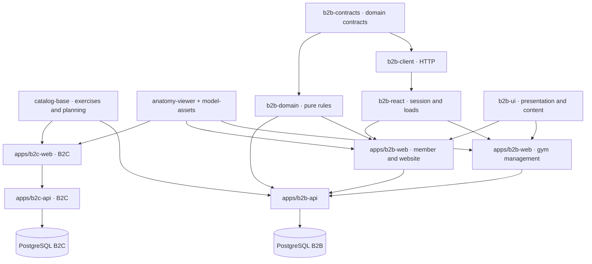

<a id="producto-b2b-catálogo-y-preparación-del-gimnasio"></a>

# B2B product: catalog and gym readiness

Gym API/PostgreSQL/credentials/sessions independent. Personal b2c-web/b2c-api/IDs/
subscriptions/storage retained. Shared code/static resources; no B2C DB/API/domain
asset dependency. [Roadmap](roadmap-implementacion.md) delivery/3D/UI design-testing.
October11 editor recovery/concurrency/time-RPE/mobile logging/optional voice/plan/
clip comparison;[code-runtime evidence](b2b-release.md) retains source revision.
[Mac](development-macos.md)/[VPS](development-vps.md) continuation. New Blender/
physical acceptance/previews pending; public pilot separately roadmap.

<a id="marca-blanca-dominios-y-varias-sedes"></a>

## White-label: domains and multiple branches

[Implemented delivery](b2b-white-label.md): organization company-brand/multiple branches
from start/domain pre-login. Same app/all domains, brand sessions/branch permissions/
member-trainer-admin destinations; config themes/templates/modules/content, not app/client.
**WL-0–WL-8 implemented**, B2B_WHITE_LABEL=true/operator verified-active domains.
[Operation](b2b-white-label-runtime.md)/[matrix](b2b-white-label-validation.md).
Single-origin/g-slug below legacy scope, not domain-branch configuration substitute.

<a id="componentes-y-límites"></a>

## Components and boundaries



| Module | Responsibility/change rule |
| --- | --- |
| packages/catalog-base | Catalog/relations/IDs/semantics; no React/auth/DB |
| packages/anatomy-viewer | Anatomy/rig/movement/3D/explicit resources/fallback; no gym-account-subscription |
| packages/model-assets | Single GLB-landmark-preview/provenance source; copy per build, retain models/previews URLs |
| packages/b2b-contracts | Domain input-response schemas/types/explicit exports; not personal formats |
| packages/b2b-domain | Shared machine compatibility/prescription-execution rules; no React-HTTP-DB-storage, app-adapted results |
| packages/b2b-client | Typed HTTP/response validation/cancellation/errors/session events, React-independent |
| packages/b2b-react | Account-session/cancellable loads/client-contract deps, no visual components |
| packages/b2b-ui | Brand/controls/injected login/styles; content subpath media/optional viewers, no main-entry load |
| apps/b2b-api | Organization/membership/permissions/local catalog/assignments/logs |
| apps/b2b-web | Public website-QR/member training-history/manage |
| apps/b2b-web/src/features/* | People/catalog/physical equipment/prescription/monitoring/identity |

Old B2C catalog-viewer files compatibility adapters. Personal store/billing/onboarding/
sync not extracted; different from prescribed training. Shared changes B2C checks;
B2B migration own DB only. check:b2b:boundaries part of lint, exports/layers/declared
deps/cycles. Public entrypoints, relative imports same workspace. Domain no browser/
Node; UI no client/session-hook imports.

<a id="qué-se-reutiliza"></a>

## Reuse

Base ID retained, local adaptation baseExerciseId never original edit. Own exercise
instructions/muscles/HTTPS-local media; animationId existing educational movement
only, new unanimated card text-image-video, no arbitrary inheritance.
Reusable **machine model**, local derivedFromId/derivedFromVersion;**physical unit**
gym-owned/identity-location-settings-media-QR, multiple per model. Archive-unpublish
invalidates public card, preserves historical prescription. Static GLB viewer, no
video→animation/nonexistent machine library implied. Initial three generic cable/
leg-press/chest-press definitions/six templates added without base ID change,
templates drafts for gym review. Anatomy provenance/notices/additional local media
attribution; highlight associated muscles, not user measurement.

<a id="recorrido-de-la-primera-entrega"></a>

## First-delivery journey

1. Admin brand/invite staff-members/assign member trainer.
2. Trainer optional own exercise/publish, base-local routine/sets/reps-or-time/load/
   optional targetRPE/rest/notes/explicit alternatives.
3. Publication immutable version; assignment snapshots exercises/models, no later catalog rewrite.
4. Member routine or unit QR; public address only, no credentials/private activity.
5. Actual sets/load/optional RPE/allowed-substitution reason; explicit partial-complete
   save, both immutable. Reload draft/pending ID retained, no duplicate retry.
6. Trainer compares assigned member prescribed/actual.

Account session/membership role per org; server org-role-trainer assignment/service,
not client navigation/IDs. Exact origin/account guard rejects old-session tabs.
Last active admin protected. B2B membership exposes no B2C.

<a id="preparar-un-gimnasio-desde-la-gestión-del-gimnasio"></a>

## Prepare gym through management

Identity/inventory/content/activities/schedules/gallery/website publication;
progress from saved data across reload/devices.

1. Name/intro/color/logo/address/contact.
2. Library model/units individually or≤20 batch; unit own name-location-settings-
   resources-visibility. Reuse not generic-card copy; adaptation local provenance entity.
3. Reference exercise/instructions/resources; draft→reviewed→published. Edit resets
   review; assigned snapshots retained. Admin-trainer exercise review/publish,
   admin owns models/inventory.
4. Draft activities/schedules/gallery/optional unit-linked plan/static space.
   Save not public replacement, publish saved revision; unpublish hides website-QR,
   retains unsaved local changes.
5. Eligible public-unit QR labels gym/unit/location/absolute link/browser print-PDF;
   no private-retired/unpublished-model candidates.

Phone-check before attachment. Demo loopback QR local host only; physical pilot
needs accessible HTTPS.

<a id="biblioteca-de-archivos"></a>

## File library

Upload once/reuse exercise-model-unit-gallery; external URL still option.

| Type | Formats | Maximum |
| --- | --- | --- |
| Photo | Static JPEG/PNG/WebP | 8 MiB |
| Video | MP4/WebM | 32 MiB |
| Static model | Self-contained core GLB 2.0 | 24 MiB |

API format/structure/ID/immutable bytes, no conversion-transcoding. No SVG/HTML
images; GLB no external/animation/skins/extensions, internal PNG-JPEG. Image≤8192/axis,
32 million pixels. Machine upload no automatic movement. New private; public via
published references, foreign URL insufficient; authorized historical snapshots
retain access, no overwrite on card edit.

Absolute dedicated B2B_MEDIA_ROOT; local .cache/b2b/media, instance-media mounted
/var/lib/klisteni-b2b/media, UID 1000 writable. B2B_MEDIA_QUOTA_MB default 256 MiB/gym.
Never Nginx static volume; API per-read permissions. Missing storage uploads unavailable,
external references work.

<a id="demo-local"></a>

## Local demo

Node 24/pinned pnpm/Docker-Compose, root:

```sh
pnpm install --frozen-lockfile --ignore-scripts
pnpm dev:b2b
```

Private .cache/b2b/local.env, only DB127.0.0.1:54330, migrate/seed:

| Entry | Address |
| --- | --- |
| Atlas website | http://127.0.0.1:4200/g/atlas-demo |
| Sur website | http://127.0.0.1:4200/g/sur-demo |
| Member | http://127.0.0.1:4200/app |
| Management | http://127.0.0.1:4200/manage |

Internal API4201/Vite4210; browser4200. Accounts .cache/b2b/demo.private.json,
B2B_DEMO_PASSWORD private env. admin@atlas.example.test/coach@atlas.example.test/
member@atlas.example.test/equivalent Sur; no repo secrets.

```sh
pnpm prepare:b2b                          # prepare the database without starting applications
pnpm dev:b2b --built                      # serve static builds
pnpm dev:b2b --prepare --reset-demo        # delete ONLY the B2B demo and reseed
```

Reset demo-marked allowed DB/demo mode/explicit confirmation; production rejects.
Local helper rejects foreign host-port-DB-origin, reseeding preserves password.
Ctrl-C apps stop/DB retains. Reset drops upload metadata, physical files remain
API-inaccessible; orphan/backup retention separate, no automatic volume deletion.

<a id="instancia-independiente"></a>

## Independent instance

deploy/compose.b2b.instance.yaml: new DB/one-shot migration/limited API/Nginx, loopback
only/operator HTTPS proxy/exact B2B_APP_ORIGIN; no automatic deploy/B2C Compose dependency.

```sh
cp deploy/b2b.env.example .env.b2b-instance
chmod 600 .env.b2b-instance
# Fill in independent secrets in the private file; use hexadecimal values for URLs.
pnpm build:b2b
docker compose --env-file .env.b2b-instance -f deploy/compose.b2b.instance.yaml build
docker compose --env-file .env.b2b-instance -f deploy/compose.b2b.instance.yaml up -d
```

postgres only initialization-migration-backup; API klisteni_b2b no superuser/DB-role
creation/DDL/migration password. B2B_NODE_ENV=production HTTPS/secure cookies;
temporary development loopback container validation not public setup.

Versioned migration before API; readiness missing fails. Upgrade backup/build/rerun
migrate before recreate. Retain images/consistent DB-media; rollback verify data
compatibility, old image cannot undo JSON/SQL. Pre-migration empty/incomplete API
restart after migrate, Better Auth caches failure; healthz200 vs readyz503 despite
tables. Auth-readiness/restart200. [Smoke](b2b-runtime-validation.md) tests case/HTTPS/
persistence/isolated restore.

<a id="compatibilidad-y-despliegue-de-esta-actualización"></a>

### Compatibility and deployment of this update

New code absent duration/RPE/plan/spatial fields→null, no published snapshot rewrite.
Not protocol compatibility: old strict Zod program-execution-website parsers reject
unknown fields even null, time reps: null formerly invalid. New API enriches old
rows, old UI INVALID_RESPONSE immediately; new UI writes may fail old API.
Coordinated API/web **one B2B frontend** member-management delivery:

1. Same-revision image IDs/maintenance window/quiesced consistent DB-media/independent restore.
2. Public maintenance, migrate new image/start-recreate API/liveness-readiness, no mixed old UI.
3. Replace web for both surfaces; reload old tabs/server cannot replace loaded JS,
   retain/recover local drafts.
4. Public/admin/member/program-assignment-history checks from reloaded pages;
   reopen after complete pair, no version negotiation/gradual mixed-contract guarantee.

New nullable fields persist in drafts/programs/snapshots/logs even unused. No SQL
migration does not imply safe downgrade. Prefer current fix. Required rollback:
quiesce/test old pair on current-data copy; incompatible→separate old backup restore/
verify before switch, preserve latest/reconcile post-backup changes. No dropping
fields/time→reps to force historical snapshot downgrade.

<a id="operación-de-la-instancia"></a>

### Instance operation

operator.ts bootstrap/create-organization/service-access/seed-demo/reset-demo;
first three runtime role/no DDL. Operator service entitlement, no B2B automatic billing.
Invitations copied/delivered manually, no email provider. Private0600
.env.b2b-operator/container UID 1000 readable, no Git; Compose already DB-session-origin,
file operation params:

| Operation | Variables |
| --- | --- |
| bootstrap | `B2B_BOOTSTRAP_EMAIL`, `B2B_BOOTSTRAP_NAME`, `B2B_BOOTSTRAP_PASSWORD`, `B2B_ORG_SLUG`, `B2B_ORG_NAME` |
| create-organization | `B2B_ADMIN_EMAIL`, `B2B_ADMIN_NAME`, `B2B_ORG_SLUG`, `B2B_ORG_NAME`, `B2B_ADMIN_PASSWORD` new identity only |
| service-access | B2B_ORG_SLUG, B2B_SERVICE_ENABLED=true-false, optional zoned ISO B2B_SERVICE_ENDS_AT |

New passwords12–128, lowercase-number-hyphen slug, after migrations:

```sh
# First gym and platform administrator; one-time operation.
docker compose --env-file .env.b2b-instance -f deploy/compose.b2b.instance.yaml \
  run --rm --no-deps --volume "$PWD/.env.b2b-operator:/run/b2b-operator.env:ro" \
  b2b-api node --env-file=/run/b2b-operator.env apps/b2b-api/src/operator.ts bootstrap

# Edit the private file with the next gym parameters.
docker compose --env-file .env.b2b-instance -f deploy/compose.b2b.instance.yaml \
  run --rm --no-deps --volume "$PWD/.env.b2b-operator:/run/b2b-operator.env:ro" \
  b2b-api node --env-file=/run/b2b-operator.env apps/b2b-api/src/operator.ts create-organization

# Change service eligibility for the gym specified in the private file.
docker compose --env-file .env.b2b-instance -f deploy/compose.b2b.instance.yaml \
  run --rm --no-deps --volume "$PWD/.env.b2b-operator:/run/b2b-operator.env:ro" \
  b2b-api node --env-file=/run/b2b-operator.env apps/b2b-api/src/operator.ts service-access
```

create-organization needs bootstrap; existing identity add admin membership, no
name-password overwrite. Exact slug/name/admin repeat created: false; different
occupied slug error/no overwrite. Base local snapshots, no B2C. Suspended-expired
service blocks new writes, authorized history retained. Omitted endsAt clears
previous expiry; retain explicitly for state-only change. Outside container:
node --env-file=/ruta/privada/b2b.env apps/b2b-api/src/operator.ts OPERACION,
full host-accessible B2B config/params; never password args/output.

Own bytes independent volume. External origin must permit access, GLB CORS;
snapshot URL-metadata not provider bytes; versioned immutable URLs for appearance history.

<a id="backup-y-restauración"></a>

## Backup and restoration

Whole DB accounts-memberships-local catalog-versions-executions plus media;
external provider references own copy. No B2C tables. Window without uploads/reset/
file removal, exclude incomplete-upload temporaries.

```sh
# Example using instance Compose; the dump contains private data.
umask 077
docker compose --env-file .env.b2b-instance -f deploy/compose.b2b.instance.yaml exec -T db \
  pg_dump -U postgres -d klisteni_b2b_instance -Fc > b2b-backup.private.dump

# Copy files after the dump. They are immutable; retain them during copying.
docker compose --env-file .env.b2b-instance -f deploy/compose.b2b.instance.yaml exec -T b2b-api \
  tar --exclude='.upload-*.tmp' -czf - -C /var/lib/klisteni-b2b media > b2b-media.private.tar.gz
```

Separate empty DB pg_restore --no-owner --no-acl --exit-on-error, never active volume.
Separate media UID 1000/B2B_MEDIA_ROOT/hash check; archive contains media folder,
extract parent or strip-components=1 to avoid media/media. Migrations/counts/login/
isolation/assigned versions/executions/public-private reads/runtime grants. Retain
session secrets or explicitly rotate to invalidate. Switch only after verification,
keep old DB/media rollback.

<a id="validación-y-próximos-cambios"></a>

## Validation and next changes

Disposable TEST_DATABASE_URL B2C/B2B_TEST_DATABASE_URL B2B/schema privilege;
B2B browser b2b/test name, no options, runner-owned schema, not runtime-role privileges.
Install Playwright chromium-webkit with deps/serial browser builds-GPU;
[matrix](b2b-browser-validation.md), check:release both DB/full gates.

```sh
pnpm check
# Only with isolated PostgreSQL test URLs configured in the environment:
pnpm test:api
pnpm test:accounts
pnpm test:b2b:api
pnpm test:b2b:e2e
```

Suites own schema cleanup; no DB checks not integration proof. Manual CI
RUN_B2B_INTEGRATION_TESTS=true disposable API/browser only. [Roadmap delivery](b2b-release.md)
time-RPE/voice-rest/equipment-website recovery/2D plan/optional static space/clip
comparison; no Blender animated importer. Historical defaults no snapshot rewrite,
existing JSONB, no B2C migration/shared tables. Responsibility-sized changes/shared
B2C regressions/B2B migrations-contracts/member-admin features/deploy. No gym condition
in B2C store/cross-DB dependencies. Machine-movement review/3D navigation/commercial
automation/transcoding separate deliveries.
