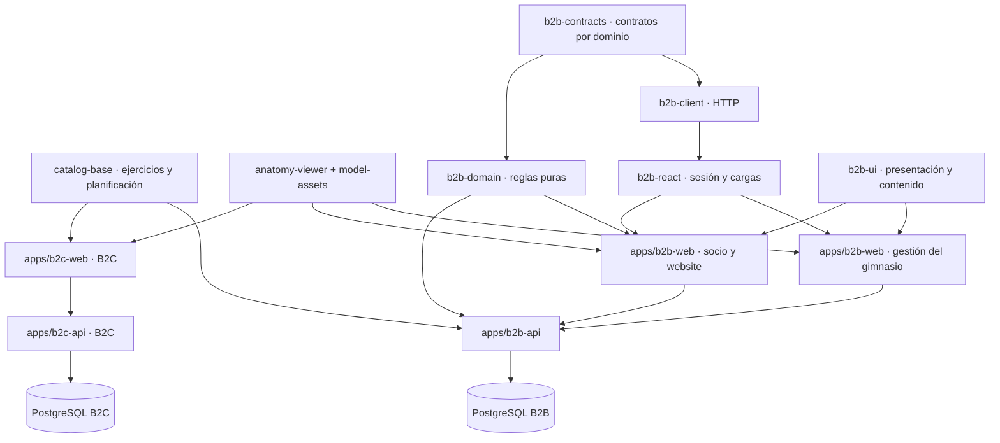

# Producto B2B: catálogo y preparación del gimnasio

El producto de gimnasios usa API, PostgreSQL, credenciales y sesiones propios. El producto individual conserva `apps/b2c-web`, `apps/b2c-api`, sus identificadores, suscripciones y almacenamiento. La reutilización ocurre mediante paquetes de código y recursos estáticos; B2B no lee la base B2C ni necesita llamar a su API o servir archivos desde su dominio.

Para el orden de próximas entregas, la producción 3D y el ciclo de diseño y prueba de UI, consultar el [roadmap de implementación](roadmap-implementacion.md). Esta guía describe el comportamiento y la operación actuales.

La entrega del 11 de octubre incorpora recuperación/concurrencia de editores, prescripción por duración/RPE, registro móvil, voz opcional, plano y comparación audiovisual. Los [resultados de código y runtime](b2b-release.md) conservan su revisión de origen. Para continuar, seguir la guía de [macOS](development-macos.md) o el [relevo al VPS](development-vps.md). La nueva autoría Blender, la aceptación física y la regeneración de previews siguen pendientes. El estado del piloto público se registra por separado en el [roadmap](roadmap-implementacion.md).

## Marca blanca: dominios y varias sedes

La entrega implementada está definida en [Marca blanca B2B](b2b-white-label.md): una organización representa una empresa/marca y tiene varias sedes desde el inicio; su dominio determina la marca antes del login. Una misma aplicación sirve todos los dominios, con sesiones de marca, permisos por sede y destinos para socio, entrenador y administrador. Temas, plantillas, módulos y contenido se configuran sin crear una aplicación por cliente.

**WL-0 a WL-8 implementados:** con `B2B_WHITE_LABEL=true`, cada dominio debe verificarse y activarse mediante el operador; sesiones y permisos quedan ligados a marca y sede. Consultar la [operación WL](b2b-white-label-runtime.md) y su [matriz de validación](b2b-white-label-validation.md). El modo de un origen y las rutas `/g/:slug` que se describen más abajo conservan su alcance legado; no sustituyen la configuración de dominios y sedes.

## Componentes y límites



| Módulo | Responsabilidad y regla de cambio |
| --- | --- |
| `packages/catalog-base` | Catálogo educativo y relaciones existentes. Mantener IDs y semántica; no importa React, auth o PostgreSQL. |
| `packages/anatomy-viewer` | Anatomía, rig, movimiento y presentación 3D. Recursos explícitos y fallback. No conoce gimnasios, cuentas ni suscripciones. |
| `packages/model-assets` | Único origen de GLB, referencias y previews con procedencia. El plugin copia archivos en cada build y conserva `/models` y `/previews`. |
| `packages/b2b-contracts` | Schemas y tipos de entrada/respuesta por dominio, con exports explícitos. No sustituye los formatos personales B2C. |
| `packages/b2b-domain` | Compatibilidad de máquinas y reglas de prescripción/ejecución compartidas. Sin React, HTTP, DB ni almacenamiento; devuelve resultados que cada aplicación adapta. |
| `packages/b2b-client` | Cliente HTTP tipado, validación de respuestas, cancelación, errores y eventos de sesión. Independiente de React. |
| `packages/b2b-react` | Contexto de cuenta, sesión y cargas cancelables. Depende del cliente y contratos; no contiene componentes visuales. |
| `packages/b2b-ui` | Marca, controles, login con acción inyectada y estilos. El subpath `/content` comparte medios y visores opcionales sin cargarlos desde el entrypoint principal. |
| `apps/b2b-api` | Organización, membresías, permisos, catálogo local, asignaciones y registros. |
| `apps/b2b-web` | Website y QR públicos; entrenamiento e historial del socio; gestión del gimnasio en `/manage`. |
| `apps/b2b-web/src/features/*` | Personas, catálogo, equipo físico, prescripción, seguimiento e identidad. |

Los archivos anteriores de catálogo y visor en `apps/b2c-web/src` quedan como adaptadores de compatibilidad. No se extraen el store personal, billing, onboarding ni sincronización B2C: sus comportamientos son distintos del entrenamiento prescrito. Cada cambio compartido debe pasar los checks B2C; una migración B2B sólo se ejecuta sobre su base.

`pnpm check:b2b:boundaries`, incluido en `pnpm lint`, comprueba las capas B2B, sus exports, dependencias declaradas y ciclos. Los consumidores importan entrypoints públicos; los imports relativos se mantienen dentro del mismo workspace. Las reglas de dominio no acceden al navegador ni a Node, y la UI no importa el cliente o los hooks de sesión.

## Qué se reutiliza

Un ejercicio base conserva su ID. Una adaptación del gimnasio es una entidad local con `baseExerciseId`; no edita el original. Los ejercicios propios admiten instrucciones, músculos asociados y medios por URL HTTPS o ruta local. `animationId` sólo puede identificar una animación educativa existente. Un ejercicio nuevo sin animación usa texto, imagen o video: no hereda un movimiento arbitrario.

Un **modelo de máquina** describe el tipo reutilizable. Una adaptación local registra `derivedFromId` y `derivedFromVersion`. La **unidad física** pertenece al gimnasio y añade identificación, ubicación, ajustes, medios y QR propios. Se pueden tener varias unidades del mismo modelo. Archivar o retirar de publicación una unidad invalida su ficha pública sin borrar las prescripciones históricas. El visor de equipamiento acepta GLB estático; no convierte videos en animaciones ni incluye por defecto una biblioteca de modelos 3D de máquinas que no exista en el repositorio.

La biblioteca inicial B2B incorpora tres definiciones genéricas —polea, prensa de piernas y press de pecho— y seis plantillas de ejercicios de máquinas. Se agregan al catálogo base existente sin cambiar sus IDs. Las plantillas nuevas empiezan como borradores para adaptar y revisar con el equipo del gimnasio.

Las referencias anatómicas conservan su procedencia y avisos originales. La atribución adicional acompaña cada medio local. El resaltado muestra músculos asociados, no mediciones del usuario.

## Recorrido de la primera entrega

1. El administrador configura la marca e invita profesores y socios; asigna socios a un profesor.
2. El profesor crea y publica un ejercicio propio si lo necesita; combina ejercicios base y locales en una rutina con series, repeticiones o duración, carga, RPE objetivo opcional, descanso, notas y alternativas explícitas.
3. Publicar crea una versión inmutable. Asignar guarda esa versión, sus ejercicios y modelos; futuras ediciones no cambian lo prescrito.
4. El socio abre su rutina o llega desde el QR de una unidad. El QR público sólo contiene la dirección de la ficha, nunca credenciales ni actividad privada.
5. El socio registra las series realizadas en la unidad prescrita, su carga, RPE opcional y el motivo de cada sustitución permitida. Guarda una sesión parcial o terminada mediante acción explícita; ambas quedan inmutables al confirmarse. El borrador sobrevive a una recarga y un envío pendiente conserva su ID para reintentar sin duplicados.
6. El profesor compara la prescripción con la ejecución de sus socios asignados.

La sesión B2B identifica una cuenta y la membresía determina su rol dentro de cada organización. El servidor verifica organización, rol, asignación del profesor y estado del servicio; no confía en la navegación o en un ID enviado por el cliente. Las mutaciones requieren origen exacto y guardia de cuenta para rechazar pestañas de una sesión anterior. El último administrador activo no puede deshabilitarse por accidente. B2C no se vuelve visible por tener una membresía B2B.

## Preparar un gimnasio desde la gestión del gimnasio

La preparación reúne identidad, inventario, contenido, actividades, horarios, galería y publicación del website. El progreso se calcula desde los datos guardados, por lo que se conserva al recargar y al cambiar de dispositivo.

1. Completar nombre, presentación, color, logo, dirección y contacto desde la identidad del gimnasio.
2. Elegir modelos de la biblioteca y registrar sus unidades físicas, individualmente o en un lote de hasta 20. Cada unidad conserva nombre, ubicación, ajustes, recursos y visibilidad propios. Reutilizar un modelo no crea una copia de su ficha genérica; crear una adaptación sí genera una entidad local con su procedencia.
3. Adaptar los ejercicios de referencia y agregar instrucciones y recursos del gimnasio. El flujo local es **borrador → revisado → publicado**. Editar reinicia la revisión; las rutinas ya asignadas conservan sus snapshots. Administradores y profesores pueden revisar y publicar ejercicios; los modelos y el inventario los administra el administrador.
4. Completar actividades, horarios y galería en el borrador del website; opcionalmente agregar un plano vinculado a unidades o una vista estática del espacio. Guardar no sustituye la versión pública: publicar aplica la revisión guardada. Retirar la publicación oculta el sitio y sus fichas QR, conservando los cambios locales aún sin guardar.
5. Seleccionar las unidades públicas disponibles desde QRs y preparar las etiquetas. Incluyen gimnasio, nombre de unidad, ubicación y enlace absoluto; el navegador permite imprimir o guardar la hoja como PDF. Las fichas internas, retiradas o cuyo modelo no está publicado no se ofrecen para imprimir.

Antes de pegar las etiquetas, probarlas desde el teléfono con la dirección accesible de la instalación. Los QR generados en la demo loopback apuntan a `127.0.0.1` y sólo funcionan en el host local; para una prueba física se necesita el origen HTTPS de una instancia accesible desde el teléfono.

## Biblioteca de archivos

La gestión del gimnasio permite subir un archivo una vez y seleccionarlo después desde la biblioteca del gimnasio para ejercicios, modelos, unidades o galería. También conserva la opción de referencias externas por URL.

| Tipo | Formatos | Máximo por archivo |
| --- | --- | --- |
| Foto | JPEG, PNG o WebP estáticos | 8 MiB |
| Video | MP4, WebM | 32 MiB |
| Modelo estático | GLB 2.0 core autocontenido | 24 MiB |

La API comprueba formato y estructura, genera el identificador y conserva archivos inmutables. No convierte ni transcodifica los contenidos; SVG y HTML no se aceptan como imágenes. Los GLB admitidos no incluyen recursos externos, animaciones, skins ni extensiones, y sus texturas internas deben ser JPEG o PNG. Las imágenes admiten hasta 8192 píxeles por eje y 32 millones de píxeles. Un modelo de máquina aportado por el gimnasio no crea automáticamente una animación del ejercicio.

Las subidas nuevas quedan privadas. Su acceso público depende de que un recurso publicado las use; conocer la URL no permite leer medios privados de otro gimnasio. Se conservan también las referencias autorizadas desde prescripciones históricas. Los archivos no se sobrescriben al editar una ficha.

`B2B_MEDIA_ROOT` indica un directorio absoluto dedicado a B2B. El helper local usa `.cache/b2b/media`; el Compose de instancia monta el volumen `instance-media` en `/var/lib/klisteni-b2b/media`, escribible por UID 1000. La cuota por gimnasio se configura con `B2B_MEDIA_QUOTA_MB` y es de 256 MiB por defecto. No servir ese directorio directamente desde Nginx: la API aplica los permisos en cada lectura. Sin almacenamiento configurado, la carga no está disponible y siguen funcionando las referencias externas.

## Demo local

Requisitos: Node 24, pnpm fijado en el repositorio y Docker con Compose. Desde la raíz:

```sh
pnpm install --frozen-lockfile --ignore-scripts
pnpm dev:b2b
```

El comando genera `.cache/b2b/local.env` privado, levanta sólo el PostgreSQL B2B en `127.0.0.1:54330`, migra, carga datos ficticios y sirve:

| Entrada | Dirección |
| --- | --- |
| Website Atlas | `http://127.0.0.1:4200/g/atlas-demo` |
| Website Sur | `http://127.0.0.1:4200/g/sur-demo` |
| Socio | `http://127.0.0.1:4200/app` |
| Gestión del gimnasio | `http://127.0.0.1:4200/manage` |

API interna: puerto 4201; Vite B2B: 4210 para socios y gestión del gimnasio. El navegador usa siempre el origen 4200. Las cuentas ficticias se listan en `.cache/b2b/demo.private.json`; la contraseña generada está en `B2B_DEMO_PASSWORD` dentro del env privado. Hay admin, coach y member por gimnasio (`admin@atlas.example.test`, `coach@atlas.example.test`, `member@atlas.example.test` y equivalentes `sur`). No se publican secretos en el repositorio.

```sh
pnpm prepare:b2b                          # preparar DB sin iniciar aplicaciones
pnpm dev:b2b --built                      # servir builds estáticos
pnpm dev:b2b --prepare --reset-demo        # borrar SÓLO la demo B2B y resembrar
```

El reset exige base marcada como demo, nombre admitido, modo demo y confirmación explícita. Producción rechaza ese modo. El script local también rechaza cambios de host, puerto, base u origen que pudieran apuntarlo a otro entorno. Sembrar otra vez no cambia contraseñas de cuentas existentes. Ctrl-C detiene las aplicaciones; conserva la base y los registros. El reset elimina los metadatos de subidas de la demo, pero conserva sus archivos físicos; quedan inaccesibles desde la API. La limpieza de archivos huérfanos y la retención de backups se gestionan por separado: no hay borrado automático del volumen.

## Instancia independiente

`deploy/compose.b2b.instance.yaml` define una base nueva, migración de una sola ejecución, API con rol limitado y frontend Nginx. Se sirve sólo en loopback; el operador conecta un reverse proxy con HTTPS y establece `B2B_APP_ORIGIN` al origen externo exacto. No hay despliegue automático ni dependencia del Compose B2C.

```sh
cp deploy/b2b.env.example .env.b2b-instance
chmod 600 .env.b2b-instance
# Completar secretos independientes en el archivo privado; usar valores hex para las URLs.
pnpm build:b2b
docker compose --env-file .env.b2b-instance -f deploy/compose.b2b.instance.yaml build
docker compose --env-file .env.b2b-instance -f deploy/compose.b2b.instance.yaml up -d
```

El rol `postgres` sólo se usa al crear/migrar y operar backups. La API usa `klisteni_b2b`, sin superusuario, creación de bases, roles o DDL. No recibe la contraseña de migración. `B2B_NODE_ENV=production` exige HTTPS y activa cookies seguras. Para una validación local del contenedor puede usarse temporalmente `development` con un origen loopback; no es la configuración pública.

Las migraciones versionadas se ejecutan antes de iniciar la API; readiness falla si falta una. Al actualizar, respaldar primero, construir las nuevas imágenes y ejecutar el servicio `migrate` de nuevo antes de recrear `b2b-api`. Conservar las imágenes anteriores y un respaldo consistente de base y medios, pero comprobar la compatibilidad de los datos antes de cualquier rollback: volver a una imagen anterior no revierte los documentos JSON ni una migración SQL.

Si la API llegó a iniciarse contra un esquema vacío o incompleto, reiniciarla después de migrar: Better Auth conserva ese error en memoria. En ese estado `/api/b2b/healthz` puede responder 200 mientras `/api/b2b/readyz` continúa en 503, aunque las tablas ya existan. Readiness verifica también la autenticación; el reinicio posterior a una migración correcta debe restablecer 200. El [smoke de runtime](b2b-runtime-validation.md) reproduce este caso, además de verificar HTTPS de producción, persistencia y restauración en recursos aislados.

### Compatibilidad y despliegue de esta actualización

La lectura de datos históricos es compatible en el código nuevo: los campos ausentes de duración, RPE, plano y modelo espacial se completan con `null`, sin reescribir snapshots publicados. Esto no garantiza compatibilidad entre versiones del protocolo. Los parsers anteriores de programas, ejecuciones y sitio web usan Zod `.strict()` y rechazan campos desconocidos incluso cuando valen `null`; además, las prescripciones por tiempo usan `reps: null`, que antes no era válido. La API nueva agrega esos campos al leer filas antiguas, por lo que un frontend anterior puede mostrar `INVALID_RESPONSE` inmediatamente, aunque nadie haya usado todavía las funciones nuevas. A la inversa, el frontend nuevo envía estos campos y la API anterior puede rechazar sus escrituras.

Actualizar `b2b-api` y la imagen `web` que contiene **un frontend B2B**, con las secciones de socio y gestión del gimnasio, como una misma entrega:

1. Preparar las imágenes de una misma revisión y registrar sus IDs. Coordinar una ventana de actualización y detener escrituras antes de tomar el respaldo consistente de PostgreSQL y medios; probar su restauración en recursos separados.
2. Con el acceso público temporalmente en mantenimiento, ejecutar las migraciones con la imagen nueva y después iniciar o recrear `b2b-api`. Verificar liveness y readiness sin exponer una combinación de API nueva y frontend anterior.
3. Reemplazar `web` con los dos frontend correspondientes. Recargar las pestañas que quedaron abiertas con la versión anterior; actualizar el servidor no reemplaza el JavaScript ya cargado. Conservar los borradores locales pendientes y completar su recuperación con la versión nueva.
4. Comprobar sitio público, acceso de administrador y miembro, programas, asignaciones e historial desde las páginas recargadas. Reabrir el acceso cuando la combinación completa esté verificada. Esta entrega no implementa negociación de versiones ni garantiza una actualización gradual entre contratos diferentes.

Guardar o publicar con esta versión puede persistir los campos nuevos en borradores, programas, snapshots y ejecuciones, incluso si sólo contienen `null`. Por eso la ausencia de una migración SQL nueva no hace seguro volver a las imágenes anteriores. Preferir una corrección con el código actual. Si es necesario retroceder, detener escrituras y validar el par de imágenes anterior contra una copia de los datos actuales; si resulta incompatible, restaurar el respaldo previo de base y medios en recursos separados y verificarlo antes de cambiar las conexiones. Esa restauración omite cambios posteriores al respaldo: conservar también el estado más reciente y definir cómo recuperar esos cambios. No eliminar campos ni convertir tiempos en repeticiones para forzar un downgrade de snapshots históricos.

### Operación de la instancia

Operaciones CLI: `apps/b2b-api/src/operator.ts` permite `bootstrap` (primer administrador y gimnasio), `create-organization` (siguiente gimnasio), `service-access`, `seed-demo` y `reset-demo`. Las tres primeras funcionan con el rol runtime y no ejecutan DDL. El operador controla acceso al servicio por gimnasio; no se implementa cobro automático B2B. Las invitaciones se copian desde la gestión del gimnasio para entregar al destinatario; esta versión no configura un proveedor de correo.

Preparar `.env.b2b-operator` como archivo privado, con permisos `0600` y legible por el usuario del contenedor (UID 1000 en esta imagen). No incluirlo en Git. El contenedor ya recibe base, secreto de sesión y origen del Compose; este archivo aporta sólo los parámetros de la operación:

| Operación | Variables del archivo privado |
| --- | --- |
| `bootstrap` | `B2B_BOOTSTRAP_EMAIL`, `B2B_BOOTSTRAP_NAME`, `B2B_BOOTSTRAP_PASSWORD`, `B2B_ORG_SLUG`, `B2B_ORG_NAME` |
| `create-organization` | `B2B_ADMIN_EMAIL`, `B2B_ADMIN_NAME`, `B2B_ORG_SLUG`, `B2B_ORG_NAME`; `B2B_ADMIN_PASSWORD` sólo si la identidad es nueva |
| `service-access` | `B2B_ORG_SLUG`, `B2B_SERVICE_ENABLED=true` o `false`; `B2B_SERVICE_ENDS_AT` opcional como fecha/hora ISO con zona |

Las contraseñas nuevas requieren entre 12 y 128 caracteres. El slug usa minúsculas, números y guiones. Ejecutar después de completar las migraciones:

```sh
# Primer gimnasio y administrador de plataforma; operación única.
docker compose --env-file .env.b2b-instance -f deploy/compose.b2b.instance.yaml \
  run --rm --no-deps --volume "$PWD/.env.b2b-operator:/run/b2b-operator.env:ro" \
  b2b-api node --env-file=/run/b2b-operator.env apps/b2b-api/src/operator.ts bootstrap

# Editar el archivo privado con los parámetros del siguiente gimnasio.
docker compose --env-file .env.b2b-instance -f deploy/compose.b2b.instance.yaml \
  run --rm --no-deps --volume "$PWD/.env.b2b-operator:/run/b2b-operator.env:ro" \
  b2b-api node --env-file=/run/b2b-operator.env apps/b2b-api/src/operator.ts create-organization

# Cambiar la vigencia del servicio del gimnasio indicado en el archivo privado.
docker compose --env-file .env.b2b-instance -f deploy/compose.b2b.instance.yaml \
  run --rm --no-deps --volume "$PWD/.env.b2b-operator:/run/b2b-operator.env:ro" \
  b2b-api node --env-file=/run/b2b-operator.env apps/b2b-api/src/operator.ts service-access
```

`create-organization` exige que el bootstrap de plataforma ya exista. Si el email corresponde a una identidad B2B existente, añade su membresía administrativa sin cambiar nombre ni contraseña. Repetir exactamente slug, nombre de gimnasio y administrador devuelve `created:false`; un slug ocupado con datos diferentes produce un error y no sobrescribe la organización. La biblioteca base se siembra mediante snapshots locales; no consulta B2C. Al suspender o vencer el contrato se rechazan nuevas escrituras del gimnasio y permanecen disponibles las lecturas históricas autorizadas. Omitir `B2B_SERVICE_ENDS_AT` elimina una fecha de vencimiento anterior: conservarla explícitamente si sólo se quiere cambiar el estado.

Para ejecutar fuera del contenedor, usar `node --env-file=/ruta/privada/b2b.env apps/b2b-api/src/operator.ts OPERACION`, incluyendo en ese archivo los parámetros anteriores y la configuración B2B completa con una conexión accesible desde ese host. Las contraseñas nunca van como argumentos ni aparecen en la salida del comando.

La biblioteca propia guarda los bytes en el volumen independiente de B2B. Para referencias externas, el origen debe permitir su carga; los GLB externos requieren CORS. Los snapshots conservan sus URLs y metadatos, pero el proveedor externo controla sus bytes: usar URLs versionadas e inmutables para conservar también su apariencia histórica.

## Backup y restauración

El backup incluye la base B2B completa (cuentas, membresías, catálogo local, versiones y ejecuciones) y su volumen de medios. Los recursos referenciados en un proveedor externo necesitan su propia copia. No se copian tablas personales B2C a B2B. Coordinar una ventana sin nuevas subidas, resets ni eliminación de archivos durante la copia; el archivo excluye los temporales de subidas incompletas.

```sh
# Ejemplo desde el Compose de instancia; el dump contiene datos privados.
umask 077
docker compose --env-file .env.b2b-instance -f deploy/compose.b2b.instance.yaml exec -T db \
  pg_dump -U postgres -d klisteni_b2b_instance -Fc > b2b-backup.private.dump

# Copiar los archivos después del dump. Son inmutables; conservarlos durante la copia.
docker compose --env-file .env.b2b-instance -f deploy/compose.b2b.instance.yaml exec -T b2b-api \
  tar --exclude='.upload-*.tmp' -czf - -C /var/lib/klisteni-b2b media > b2b-media.private.tar.gz
```

Restaurar primero en una base vacía separada con `pg_restore --no-owner --no-acl --exit-on-error`, nunca encima del volumen activo. Restaurar también el archivo de medios en un volumen separado con propietario UID 1000, apuntar `B2B_MEDIA_ROOT` a ese volumen y comprobar los hashes guardados en la base. El archivo contiene la carpeta `media`: extraer desde su directorio padre o usar `tar --strip-components=1` al extraer directamente dentro del volumen para evitar `media/media`. Verificar migraciones, conteos, login, aislamiento, versiones asignadas, ejecuciones y lectura de medios públicos/privados. Conceder permisos al rol runtime de esa base restaurada antes de probarlo. Conservar secretos de sesión o rotarlos explícitamente si se desea invalidar sesiones. Sólo cambiar la conexión de la API tras validar la restauración; conservar la base y los medios anteriores para volver atrás.

## Validación y próximos cambios

Para las pruebas de integración, exportar `TEST_DATABASE_URL` para B2C y `B2B_TEST_DATABASE_URL` para B2B, apuntando a bases de prueba desechables. El usuario de prueba debe poder crear schemas. El navegador B2B exige que el nombre de la base incluya `b2b` y `test` (por ejemplo, `klisteni_b2b_test`) y que la URL no incluya el parámetro `options`: el runner administra su propio schema. Estos permisos de prueba son distintos de los del rol runtime de una instancia.

Instalar Chromium y WebKit con `pnpm --filter @klisteniapp/b2c-web exec playwright install --with-deps chromium webkit`. Ejecutar las suites de navegador en serie para evitar competir por los builds y recursos gráficos. La [matriz](b2b-browser-validation.md) cubre escritorio, táctil y comparaciones visuales; `pnpm check:release` exige ambas bases y reúne las comprobaciones completas.

```sh
pnpm check
# Sólo con URLs de PostgreSQL de prueba aisladas en el entorno:
pnpm test:api
pnpm test:accounts
pnpm test:b2b:api
pnpm test:b2b:e2e
```

Las suites B2B crean y eliminan su propio schema de prueba. Los checks sin PostgreSQL no acreditan la integración. CI conserva la política de ejecución explícita de suites pesadas: `RUN_B2B_INTEGRATION_TESTS=true` desde una pipeline manual ejecuta API y navegador sobre PostgreSQL desechable.

La [entrega del roadmap](b2b-release.md) agrega prescripciones por segundos y RPE opcional, voz y descanso, recuperación de equipamiento/website, plano 2D, vista estática opcional del espacio y comparación de clips. La vista 3D acepta modelos estáticos; no importa clips animados de Blender. Los campos nuevos se decodifican con defaults compatibles en snapshots históricos sin reescribirlos; su persistencia usa los JSONB existentes, sin migraciones B2C ni tablas compartidas.

Para continuar, mantener cambios revisables por responsabilidad: catálogo/visor con regresión B2C; migraciones y contratos B2B; nuevas capacidades de socio/backoffice; despliegue. No añadir condicionales de gimnasio al store B2C ni dependencias entre sus bases. La autoría/revisión de máquinas y movimientos, el recorrido 3D con navegación, automatización comercial y transcodificación de medios requieren sus entregas propias.
