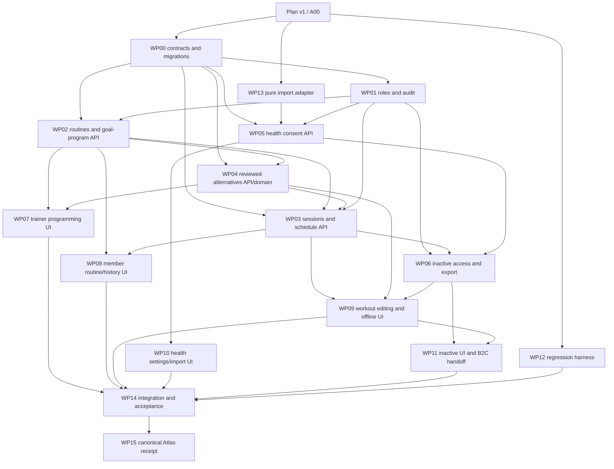

# Klisteni B2B development plan v1

Status: actionable implementation proposal; A00 evidence and dispatch preparation.
Date: 2026-10-17. Repository: `pablitxn/klisteniapp`.
The parent coordinator retains task creation, dispatch, monitoring and merge authority.
This documentation PR implements no product feature and authorizes no deployment.

## 1. Authority, revisions and deliverables

| Source | Verified revision / scope |
| --- | --- |
| Application current main | `d65261d18de4522fb9a66104aabb5750104fb8b8`; fetched on 2026-10-17; clean starting tree |
| Atlas current main | `ce45d206a2ed4035f8003a3303abd1fff98e09b8`; PR18 merged; fetched and fast-forwarded clean checkout |
| Planning branch | `docs/b2b-development-plan-v1`, based on the application SHA above; its published commit is the version receipt |
| Product authority | [October 17 minutes](https://github.com/pablitxn/sysadmin-workspace/blob/ce45d206a2ed4035f8003a3303abd1fff98e09b8/atlas/entries/2026-10-17-klisteni-b2b-product-definition.md) and [source](https://github.com/pablitxn/sysadmin-workspace/blob/ce45d206a2ed4035f8003a3303abd1fff98e09b8/atlas/sources/src-20261017-klisteni-b2b-product-definition.md) |
| Owning roadmap | [A00-A08](https://github.com/pablitxn/sysadmin-workspace/blob/ce45d206a2ed4035f8003a3303abd1fff98e09b8/atlas/roadmap.md#klisteni-b2b-product-definition---2026-10-17); this plan decomposes those IDs, without creating a second product backlog |
| Consulted synthesis | Atlas `wiki/klisteniapp.md`, `wiki/decisions.md`, `wiki/open-questions.md` at the pinned Atlas SHA |

Read both root `AGENTS.md`, Atlas `atlas/AGENTS.md`, local `.agents/skills/atlas-navigate/SKILL.md` and `atlas-maintain/SKILL.md`, source-of-truth/privacy policies, and language, PR/integration and Cloud identity standards. The app AGENTS' warning that the language directive is pending is stale: the refreshed Atlas contains it. Follow the adopted directive without rewriting that historical instruction in this planning change.

Companion deliverables:

- [Work packages, ownership, acceptance and exact test targets](klisteni-b2b-development-v1-work-packages.md).
- [Ready-to-dispatch prompts](klisteni-b2b-development-v1-prompts.md) and [dispatch manifest](klisteni-b2b-development-v1-dispatch.json).
- [Current baseline checks and limits](klisteni-b2b-development-v1-baseline.md).
- Detailed read-only evidence: [training](klisteni-b2b-development-v1-evidence-training.md), [access and health](klisteni-b2b-development-v1-evidence-access-health.md), [alternatives and UI](klisteni-b2b-development-v1-evidence-alternatives-ui.md).

Implementation and testing are separate from deployment. Preserve KLI-01, WL-0-WL-8, October 12/16 records, current-main QA, Yoga/content/archives/CI/provider/backup/device/release gates and their existing owners. All development uses local/dev synthetic identities, files and databases. No real-user data, health-provider access, paid service, credential changes, production operation, history rewrite or force push is in this batch.

## 2. Decision-to-code evidence matrix

Paths below refer to application baseline `d65261d`; line references and named existing tests are expanded in the evidence appendices. "Implemented" describes the named subfeature, not acceptance of the entire new decision. A passing old test may enforce a contract this batch must deliberately supersede.

| Decision / owner | Implemented and reusable | Partial, missing or conflicting | Exact code / existing tests |
| --- | --- | --- | --- |
| d01 / A01 roles and audit | Admin/coach/member roles, brand and branch grants, transactions recheck authorization, actor/action/resource/time audit | Missing organization superadmin; coaches limited to assigned students; audit lacks changed content and read UI. All-user shift coverage must remove assignment restriction without widening branch/tenant grants | `packages/b2b-contracts/src/common.ts:11`; `apps/b2b-api/src/organization-context.ts:33-41`; `service.ts:223-302`; `training/repository.ts:133-194`; `white-label-access.ts`; `tests/integration.test.ts:1701-1732` asserts assigned-only behavior; `tests/white-label-authorization.test.ts` |
| d02 / A02 completeness and drafts | Routine editor, publishing, assignment, equipment checks; no balance score found | Server drafts require at least one fully configured step; local incomplete drafts cannot save to server. Split permissive draft and assignable validation | `packages/b2b-contracts/src/training.ts:5-41`; `apps/b2b-api/src/training/index.ts:52-130`; `apps/b2b-web/src/features/programs/ProgramEditor.tsx`; `programDraft.ts`; `packages/b2b-contracts/tests/roadmap.test.ts`; `apps/b2b-web/tests/editorModels.test.ts` (all package/app prefixes as above) |
| d03 / A02,A03 goal programs and two histories | Stable flat Program (a reusable routine), immutable ProgramVersion; assignments retain version; actual history includes variants | Missing goal program, dated stages, enrollment/periods, today/past/future presentation, routine continuity view and bidirectional routine/session links | `packages/b2b-contracts/src/training.ts:26-125,161-201`; `apps/b2b-api/src/training/repository.ts`; `apps/b2b-web/src/features/training/{AssignedRoutines,ExecutionHistory,HistoryPage}.tsx`; API `tests/integration.test.ts:486`; browser `e2e/b2b-member-roadmap.spec.ts` |
| d04 / A03 durable records across period moves | Immutable version snapshots and relational original assignment linkage already exist | Periods and period-edit reconciliation absent. Must not rebuild history from current routine/catalog or cascade delete logged work | `apps/b2b-api/src/database.ts:26-30`; `white-label-schema.ts:136-142`; `training/index.ts:108-130`; `training/repository.ts:169-207`; `tests/white-label-migration.test.ts`; `tests/integration.test.ts` immutable-history cases |
| d05 / A04,A05 week scheduling and editable logs | Partial/completed validation, account/branch-scoped local drafts, response-loss retry identity, explicit completion controls | No B2B prescribed occurrence/week ledger. Confirmed records POST-only immutable; own editing and automatic durable outbox absent. B2C personal weekly plan cannot substitute for B2B prescribed accounting | `packages/b2b-domain/src/training.ts:44-96`; `apps/b2b-web/src/features/training/{sessionDraft,useTrainingSession,Session}.ts*`; `Session.tsx:147-149`; `apps/b2b-api/src/training/index.ts:209`; `apps/b2c-web/e2e/member-qa.spec.ts:418,546,581`; `apps/b2b-web/tests/sessionDraft.test.ts` |
| d06 / A02 prescriptions | Fixed sets/reps OR seconds, load kg, rest, RPE, notes | Missing fixed/range targets and explicit applicability/completeness rules. Actual logs and targets must remain distinct | `packages/b2b-contracts/src/training.ts:5-24,127-159`; `apps/b2b-web/src/features/programs/ProgramStepEditor.tsx`; `packages/b2b-domain/tests/training.test.ts`; API `tests/training.test.ts` |
| d07 / A06 reviewed alternatives | Canonical catalog verified: 37 exercises/42 directed relations (8 alternatives, 17 progressions, 17 regressions), validator clean. B2B allowlisted per-set substitution, actual variant/reason, snapshots and load reset exist | B2B projection drops reviewed metadata. Current alternatives are arbitrary trainer IDs; no default reviewed options, explicit routine-step block/notice or target dose. Current rules use source measurement/count | `packages/catalog-base/src/exercise-planning.ts:209-285`; `packages/scene-schema/src/exercise-planning.ts:81-159`; `apps/b2b-api/src/catalog/seed.ts:6-29`; `packages/b2b-contracts/src/catalog.ts:77`; `packages/b2b-domain/src/training.ts:55`; `apps/b2b-web/src/features/training/sessionDraft.ts:193`; `SessionStep.tsx:158-183`; catalog/planning/domain/draft/API tests listed in alternatives evidence |
| d08 / A07 manual health and consent | B2C normalized Klisteni JSON parser/preview/dedup/conflict rejection, owner-only personal records/dashboard | No B2B health store/consent/read enforcement/settings. No automatic provider should be added. Existing JSON supported; other formats remain unsupported until selected and tested | `apps/b2c-web/src/lib/health-import.ts`; `packages/scene-schema/src/health.ts`; B2C personal API/store and health tests (exact inventory in access appendix); `docs/{health-import,health-integrations,health-dashboard}.md`; absent B2B health routes/contracts confirmed against `http.ts`, `service.ts`, `b2b-contracts/src` |
| d09 / A08 inactive and separate B2C | Membership revocation retains DB history; active members have self-history/export; admin historical queries; separate B2C app/API/identity/billing already exist | Inactive brand login rejected and memberships omitted from me; existing export requires active membership. Need purpose-limited inactive session/export, invitation, reactivation and queue enforcement; no automatic B2C conversion | `apps/b2b-api/src/http.ts:270-294`; `service.ts` me/organization/updateMembership; `white-label-access.ts`; `apps/b2b-web/src/features/training/HistoryPage.tsx`; `docs/b2b-white-label-decisions.md:112-115` old exit policy; existing membership/history tests |

The current four apps and ten packages, unified/white-label UI, domain resolution, inventory/media publication, branch grants, immutable snapshots and manual personal health import are retained. B2B domain screens live in `apps/b2b-web`, even when Playwright tests live in `apps/b2c-web/e2e`. Do not build a second B2B consumer application, duplicate a session controller, import B2C app code into B2B, or bypass `scripts/check-b2b-boundaries.mjs`.

## 3. Technical contracts to freeze before consumer work

These are implementation decisions proposed under the authorized architecture mandate, not claims that Pablo chose each field name. WP00 turns them into an owner-repo ADR, executable schemas, fixtures and migration tests. Record any justified amendment before dispatching affected consumers.

### C01. Authorization, role mapping and audit

- Tenant = existing `organization_id` (brand/customer). Operational resources retain `branch_id` and explicit grants. Remove coach-to-student assignment as a permission prerequisite **inside the selected authorized branch**. Coach assignments can remain informational. Do not grant another branch implicitly, infer platform access, or aggregate by the highest role on another branch.
- Legacy branchless paths must resolve a deterministic permitted Principal branch or require explicit branch context before sharing trainer coverage. Removing only the assigned-coach SQL predicate while leaving `branch_id=NULL` is unsafe. Test unified and white-label paths; fail closed for ambiguous branchless requests.
- Add organization role `superadmin`, retain wire identifiers `coach` (trainer) and `member` (user). Keep `b2b_platform_admin` separate. Superadmin inherits own-brand admin powers and may create admins/coaches/members; admin creates coaches/members; neither role receives platform domain/service/operator powers by promotion.
- Existing full brand admins already create admins. Capability-preserving migration maps these existing organization admin memberships to organization superadmin, without changing user IDs, platform authority or branch grants. New admin has the narrower product role. Audit the migration and test the last-superadmin safeguard. Do not infer roles from names/email. See Q-P1 below for broader site coverage; this migration rationale must be explicit in the ADR.
- Every planning/routine/publish/assignment/period/schedule/log-correction/permission/consent change records actor, tenant, branch, resource, action, server time, request ID and before/after revision plus bounded changed-field metadata. Preserve old audit rows; absent old payload means unknown. Store immutable revision references rather than duplicating health/log payloads in general audit. Admin/superadmin and authorized trainers can inspect planning changes in scope; no raw health values or cross-tenant history. No new automatic purge/retention claim.

### C02. Routine, goal program, stage and prescription

- Preserve existing `Program`/`b2b_program` as the reusable routine and `ProgramVersion` as its immutable publication. Do not rename tables/IDs or pretend old flat routines were goal programs. UI terminology may clarify routine versus goal program.
- Add `GoalProgram` (stable ID, name, objective, revision, draft/active/archived), `GoalProgramRevision`, and member `ProgramEnrollment` with tenant/branch/member identity, immutable issued revision and subsequent period revisions. The initial goal program is member-scoped through its enrollment; no generic program-template catalog is required. A stage has stable ID/order/name, inclusive local `startDate`/`endDate`, routine-version references and explicit weekly slots (stable slot ID, ISO weekday 1-7, routine reference). Two slots may share a day; quantity is occurrences, not distinct days.
- Stages are ordered and nonoverlapping within one enrollment, with start <= end. Drafts may omit unfinished dates/routines. Activation requires complete stages and schedule; gaps are explicit no-prescription days, not invented absences. Simultaneous separate enrollments remain distinct; never merge occurrences by date. No automatic legacy weekly schedule or invented historical goal/date backfill.
- DraftRoutine allows empty steps and unset applicable dose fields. Assignment/publishing an assignable version returns structured missing-field issues by step ID. Check completeness, IDs, numeric bounds, date consistency and available authorized resources; do not grade training balance, suitability or objective quality.
- `NumericTarget = {kind:'fixed', value} | {kind:'range', min, max}` with explicit unit at field/type boundary. Sets and reps are positive integers; duration positive seconds; external load nonnegative kg; rest nonnegative seconds; notes optional bounded text; RPE optional current 1-10. Retain current maxima unless an evidence-backed amendment is made. No implicit unit conversion. Bodyweight uses explicit load mode `bodyweight`; external load requires its target; `unspecified` is allowed in drafts only when load is required. Rep-based steps require reps; timed steps require duration; source and target mode may differ. Missing fields differ from zero and from not applicable.
- Assignment completeness requires exercise, sets, one declared rep/time mode and its target; load only for explicit external-load mode; rest may use an explicitly persisted default (60s, matching current behavior); notes/RPE are optional. Preserve per-side semantics from reviewed target requirements. Actual values remain actual scalar records, never inferred from target ranges.

### C03. History and additive data model

Use additive, tenant-scoped tables; final SQL names/types belong exclusively to WP00. Proposed names below are reserved interfaces for consumer work.

| Table / record | Identity and compatibility requirement |
| --- | --- |
| `b2b_goal_program`, `b2b_goal_program_revision` | Tenant/branch + stable program ID + immutable revision; revisions retain objective/stages/routine-version links |
| `b2b_program_enrollment`, `b2b_enrollment_revision` | Member/branch, issued program revision, effective period/schedule revision; old revisions retained |
| `b2b_training_occurrence` | Stable occurrence ID, tenant/branch/member/enrollment/stage/slot/ordinal, immutable original routine-version assignment, original and effective scheduled dates, eligibility/cancellation reason and revision |
| `b2b_session_record`, `b2b_session_revision` | Current editable record and append-only accepted revisions; original assignment/routine/occurrence links immutable, performed local date/time, status, effective target/actual sets, actor and received time |
| `b2b_training_operation` | Unique tenant/member/client operation ID, normalized request hash and result revision; exact retries return prior result, reused ID/different payload conflicts |
| `b2b_health_record`, `b2b_health_consent` | B2B owner data and revocable, versioned scoped grant; no B2C DB dependency and no consent-by-import |
| `b2b_audit` extension | Add nullable scope/revision/change-reference fields; retain all historical rows |

All new cross-resource FKs include tenant/branch/member where relevant. Do not add destructive cascades to routine versions, assignments, occurrences, sessions or revisions. A correction appends a revision; archiving a routine/period removes future operational selection but never original linkage. An execution view shows the issued routine/version and actual variants; a routine continuity view shows objective/stages/periods and links to sessions, with no substitution count.

Legacy executions remain byte-preserved in `b2b_execution`; a compatibility view/adapter exposes revision 0 using existing IDs and immutable assignment/version joins. First user edit creates revision 1 linked to that legacy record. Existing exact POST replay remains idempotent and changed-content POST remains 409. New correction endpoint uses expectedRevision. Do not fabricate a scheduled occurrence for a legacy ad hoc execution; show it as legacy/unplanned history. Do not reinterpret missing old snapshot fields as newly reviewed substitution evidence.

### C04. Occurrence ledger, weeks and period moves

- One prescribed occurrence is one required session. A unique enrollment/stage/slot/ordinal key prevents regeneration/retries from increasing quantity. Ordinals are allocated once and never renumbered when an earlier slot/date is added or removed. Persist IDs; moving a date updates schedule revision, never deletes/recreates the occurrence. Routine/content/version remains unchanged for member rescheduling.
- Week is Monday 00:00 through next Monday 00:00, half-open, in enrollment IANA timezone frozen at activation. Store dates as dates and instants separately; use calendar arithmetic across DST. Require explicit timezone confirmation for new enrollment; UTC may be prefilled for synthetic fixtures, never silently inferred as a gym timezone. Timezone changes apply only to a new planning revision and cannot reinterpret old dates.
- Member move must remain in the same effective week, for an own pending/partial occurrence; reject changing quantity/content, another user's occurrence, archived/inactive access or an already completed occurrence's original performed date. Actual corrections use the log API. Multiple same-day occurrences remain separate. A midweek stage boundary cannot silently invalidate an accepted same-week move: retain the original stage/routine and an explicit permitted-date override for this schedule revision. The accepted scheduled date must be completion-eligible; changing a later period must include that override in the impact preview.
- Week summary is derived/versioned, not incremented counters: required = eligible occurrence IDs; completed = eligible occurrences fulfilled by one latest non-voided explicitly completed record; partial remains partial; missed = required minus completed at week close. Before close, outstanding is pending, not missed. Four prescribed/three completed = one missed; two completed records cannot satisfy one occurrence twice or fill another automatically.
- An actual record has immutable original links plus current revision of owner-entered performed date/time. Save/sync cannot complete it. Complete requires explicit user intent and domain-valid positive actual measurements for each required set in the effective dose; being below target reps/load does not itself invalidate truthful completion. For ranged sets the minimum is required, extra sets remain actual records. A legitimate completion correction can reduce adherence again.
- Period edits append enrollment/schedule revisions and reconcile by stable occurrence identity. Never change actual performed date/time or original routine linkage. Keep removed/out-of-window occurrences as excluded, with reason; new schedule slots get new IDs. An existing linked actual record counts only when its performed date is inside the effective prescribed week and permitted window (including an accepted same-week date override); show excluded actual work in history. Cross-week period moves recalculate both affected weeks, without copying a completion or retaining two absences. Return an impact preview before committing a trainer period move; commit with the preview's expected enrollment/schedule revisions atomically or reject stale previews. Assert completed <= required, and never use excluded/legacy work to fill another occurrence.
- Late offline submissions and user corrections are accepted subject to current authorization and optimistic revision. Keep performedAt and server receivedAt distinct; reject future performed dates. Recompute affected closed summaries and show a correction revision/time. This reversible derived-close policy avoids losing truthful late work; contractual frozen-score/grace-window policy is optional Q-P2, not a prerequisite for local development.

### C05. Editable logs, local durability and sync

Keep the existing single session controller/account provider. Extend current scoped session drafts through a versioned IndexedDB store/outbox; migrate readable local draft versions without overwriting unreadable data. Keys include origin/brand/branch/account/session, and operation IDs survive reload and lost responses. No new offline-start/service-worker guarantee is implied.

Lifecycle: `draft -> partial -> completed`, with explicit completion intent; corrections create revisions, including completed-to-partial if requested. Saving a draft can have zero sets. A user may void their own mistaken record with a retained correction/tombstone; a voided record does not satisfy adherence. This is distinct from statutory erasure/retention handling. Trainers edit planning, not another user's actual measurements.

Sync state is independent: local-only / pending / syncing / synchronized / conflict / failed / authorization-blocked. Autosave persists locally before reporting success; synchronization is reported only after server acknowledgement. Use expectedRevision + per-operation idempotency, serialize dependent operations for one record, bounded retry/backoff, and explicit conflict resolution showing local/server versions. Never silently last-write-win or apply health-import conflict semantics to workouts.

Every retry checks current membership, branch grants, consent where relevant and session context. Inactive accounts pause writes and retain recoverable owner-local work for explicit export; they cannot queue an authorized write by changing the client state. Logout/account/brand changes cancel requests and hide prior private memory immediately; the app does not render or replay stored outboxes until the same authenticated identity returns (IndexedDB is not cryptographic isolation from other users of the browser profile), with no automatic transfer to another account. Storage quota/failure must be visible. Test two tabs/devices, lost response, stale revision, account switch, revoke/reactivate and deleted/voided records.

### C06. Reviewed alternatives and effective target dose

API projects reviewed metadata from `catalog-base` through B2B contracts. Keep package boundaries; web/domain/client do not import the catalog or B2C components. Existing seed uses ON CONFLICT DO NOTHING: CONTRACT must supply an explicit versioned metadata migration/projection for already-installed, verified unchanged canonical base rows. Updating the seed alone does not deliver this feature; modified local rows and old published snapshot JSON stay untouched. Verify canonical source IDs/version/hash. An edited local adaptation does not inherit reviewed relations merely because baseExerciseId/animationId matches.

New routine versions use explicit `substitutionPolicy: reviewed | blocked` per step, default reviewed. Include available directed alternative/progression/regression relations and declared conditions; do not infer reverse/transitive relationships. Block applies only to that step in that routine and has a brief accessible notice. Empty reviewed list is an honest different state. Equipment availability and user confirmation of target requirements/conditions remain necessary; no individual trainer approval workflow.

At publication/assignment freeze reviewed relation provenance, conditions and target-dose snapshot, or create an immutable supplement for an existing legacy assignment when adopting new reviewed behavior. Never edit the original snapshot. Legacy manual allowlists remain labelled legacy authorizations; they are not proof of catalog review. Reconciliation exposes reviewed options with own dose for eligible unchanged canonical exercises; local/unsupported targets remain unavailable until reviewed. Empty legacy lists are not silently interpreted as an explicit trainer block.

Each original routine step has one selected effective-prescription segment. Every segment has stable segmentId, originalStepId, relation/target/dose snapshots and condition acknowledgments; every performed set has stable performedSetId, segmentId, set ordinal and applicable side identity. Switching target during a workout creates a new segment, retains earlier actuals as additional work, resets incompatible measurements/load/RPE and uses the target rep/time/sets/rest/per-side rules. Source-segment work is not automatically credited toward the new target: no equal-load/effect claim. Switching back may explicitly restore a prior segment only when its frozen prescription matches exactly. Completion requires each original step's selected segment to satisfy its target minimum required set/per-side coverage and explicit user completion; earlier segments remain visible/exported without double-counting. Selection never deletes actual sets. WP00/WP04/WP03 freeze source-to-target count/unit/laterality and mid-session fixtures before WP09 enables the UI.

### C07. Health privacy and inactive access

- Preserve current Klisteni JSON validation/preview/dedup behavior through a pure parser boundary. Extract reusable parsing only if app-layer imports would violate ownership; do not copy an importer into B2B. `HealthImportAdapter` declares format/version/capabilities and returns normalized records/issues/preview. Unsupported CSV/ZIP/vendor formats fail honestly. Manual file selection + explicit import only; no watch OAuth/polling/provider access.
- Store B2B health under its B2B identity with provenance, independent of B2C storage. Import does not grant sharing. Default deny for trainer/admin/superadmin. Grant identifies user, organization, authorized trainer audience/branch scope, selected categories and version; trainer role alone is insufficient. Initial audience is the dynamic set of authorized trainers in the selected branch, including staff who later gain that branch role; disclose this explicitly at grant time. Future named-trainer grants are Q-P3. B2B owner health records are keyed by the B2B identity, while each organization/branch disclosure requires its own grant; never merge B2C records automatically.
- Server checks consent on every health disclosure; the initial trainer capability is online view-only with no bulk health export. Owner export remains available; adding trainer export would require an explicit consent scope and policy amendment. Health writes are owner-only. Revoke increments version inside the authorization transaction, denies later reads, cancels/clears client views, uses no-store, no trainer persistent/offline cache, and excludes health from general gym exports/audit. A disconnected trainer UI must hide health until it can revalidate; already delivered/exported bytes cannot be recalled. Do not promise absolute deletion from a recipient's device. Retention/legal erasure and controller/processor language require their own policy; no assertion that a gym owns all personal data.
- Chosen conservative inactivity policy: the membership-deactivation transaction revokes all owner-to-gym health grants for that organization, increments grant/access versions and records the revocation audit and invalidates views. Other organizations' grants are unchanged. Reactivation never restores consent; a fresh explicit owner grant is required. This resolves revocation access while keeping inactive gym access export-only; it is an implementation policy, not an attributed quote from the minutes.
- Inactive membership gets a purpose-limited authenticated session on the correct existing brand, with `accessMode: export-only`, own record export and a separate paid B2C invitation. Keep host/domain-generation/session binding; no foreign/no-membership login. Operational authorization remains denied for inventory, planning, private media, gym history browsing, health sharing, session writes and queued synchronization. Export includes own issued routines/version lineage, accepted original and corrected actual-record revisions and own health, with a versioned manifest and omissions explained; unsynced owner-local data is a separate clearly labelled export, never represented as server-accepted; no staff/other-member private material.
- Current gym staff retain authorized historical training access for inactive members; health sharing has been revoked by the inactive transition and cannot follow the training-history permission. Reactivation restores existing records and retained grants, never resurrects explicitly revoked branch grants. Multi-membership status is tenant-specific; no active membership in another tenant unlocks this one. B2C invitation links to separate onboarding only; no shared cookie/account conversion, billing change or automatic data transfer. A compatible versioned training export/explicit B2C import adapter is optional user-selected transfer, never an implicit conversion.

### C08. HTTP and migration compatibility

Freeze new endpoints under the existing `/api/b2b/orgs/:orgId` namespace and server-selected context: `/goal-programs`, `/enrollments`, `/occurrences`, `/weeks/:weekStart`, `/session-records`, `/health/import-preview`, `/health/import`, `/health/consents`, `/health/records`. Use purpose-limited `/api/b2b/self/exports` and access-state response for inactive accounts. Schemas define methods, request/response envelopes, structured missing fields, expectedRevision and operationId before clients are dispatched. UI never sets tenant/member authority through payload alone.

Old v1 response shapes and strict decoders remain supported only for compatible v1 records; no mixed-format payload is sent. Add storage format-version discriminators to mutable routine rows and published-version rows (default 1); new incomplete/range/segment snapshots use v2. Existing v1 JSON is byte-preserved, and readers inspect the discriminator before parsing. V1 endpoints encountering a v2 resource return explicit UPGRADE_REQUIRED, never stale/flattened content or a raw decoder failure. The role migration also changes /me/member/invitation enums: use versioned identity DTOs or an explicit minimum-client/capability gate and coordinated UI/API activation before emitting superadmin. Pending legacy admin invitations preserve their issued administrator-creation capability through explicit migration disposition to tenant superadmin; newly issued admin invitations use the narrower role. Cached role contexts and durable pending requests are reauthorized, never silently promoted or replayed under a different role. New DTOs use explicit `schemaVersion`/capability negotiation; adding optional server fields still breaks old `.strict()` clients and is not sufficient compatibility. New clients handle old legacy snapshots by versioned adapters; legacy clients never receive incompatible v2 records through v1 endpoints. Once a record uses v2 ranges/targets/stages, it cannot be silently flattened for an old client; provide an explicit upgrade-required response/capability gate. Coordinate both B2B builds with the API; do not promise arbitrary old-binary rollback.

Append migrations after `005-branch-publication-profile`; never edit 001-005. WP00 reserves migration IDs and is sole writer of migration registration/readiness/decode fixtures. Expand tables/constraints, deterministic backfill, anomaly checks, indexes, then enable consumers. Migration rerun must be idempotent; fail on cross-tenant anomalies instead of repairing by guessing. Check old snapshots byte/hash stability, row counts, IDs/FKs, no lost execution/audit/media links, and roles/grants. No synthetic schedule backfill. Readiness requires the new explicit migration; server startup does not perform DDL. Roll forward with a compatible binary; any future restore needs a separately authorized coordinated DB/media/config recovery and accounting for post-backup writes.

## 4. Safe decisions and genuine product questions

| Question | Workable decision / remaining product choice | Blocking scope |
| --- | --- | --- |
| Atlas Q01, Q-P1 | Preserve brand tenant and explicit branch grants; shared trainer coverage inside authorized branch. Org-superadmin distinct from platform operator; preserve existing full admin capabilities by migration. Whether every trainer must receive all branches in a brand is not established by the minutes | Only broader cross-branch policy/acceptance; do not block branch-scoped coverage or other packages |
| Q02 | C02 defines permissive drafts, typed fixed/range targets, no scoring, immutable routine versions, ordered nonoverlapping stages, explicit schedule/timezone | No general blocker; trainer-specific prescription policy can be amended with evidence |
| Q03 | C03/C04 choose append-only snapshots/revisions and stable occurrences; history never depends on mutable current catalog | No blocker after WP00 fixtures freeze |
| Q04/Q05, Q-P2 | Derived week close, late corrections reopen versioned summary; CAS conflicts, no silent merge; timezone explicitly set at enrollment | Frozen reporting/grace deadlines, if required later, need product choice; do not block truthful logs or derived adherence |
| Q06, Q-P3 | Keep JSON and adapter boundary; no vendor format claimed. Consent UX explicitly scopes authorized trainers/categories and no offline trainer cache | Vendor adapter waits for selected anonymized samples; individually named trainer grants can extend initial clearly disclosed branch audience |
| Q07 | Export-only capability, retained gym training history, reactivation, separate B2C invitation; existing identities/products retained | Commercial price/copy, legal retention/controller terms and any B2C transfer consent wording need product/legal owner; no paid integration or automatic conversion dependency |

Escalate only if the parent requires a different policy at one of these boundaries. No request to reopen d01-d09, and no blanket permission gate for already authorized development. Do not market local policy proposals as legal compliance.

## 5. Waves and integration order

The complete package definitions and prompts are linked above. Minimal first dispatch is **WP00 only** (critical contracts/migration owner), plus independent **WP12** harness/scenario preparation if the parent wants parallel throughput. WP13 may inventory/freeze existing parser fixtures immediately, but code extraction starts only after WP00 reserves its pure API/destination and INTEGRATION leases its export/dependency wiring. These preparation tasks have disjoint paths. Do not dispatch feature consumers against unfrozen contracts.

Practical waves: W0 WP00 + optional WP12/WP13 preparation (extraction after boundary reservation); W1 WP01 plus WP02/WP03/WP04/WP05 implementation against frozen auth interfaces (API acceptance waits for WP01); W2 WP06 and WP07/WP08/WP09/WP10; W3 WP11 and WP14 combined verification; W4 WP15 evidence-only reconciliation. The parent can reduce concurrent task count; one writer per reserved path is mandatory.

**Explicit integration sequence:** planning receipt -> WP00 -> WP13 (if extracted) -> WP01 -> WP02 -> WP04 -> WP03 -> WP05 -> WP06 -> WP07 -> WP08 -> WP09 -> WP10 -> WP11 -> WP12 final test patch -> WP14 combined candidate -> WP15. WP03 consumes WP04 effective-dose rules before final integration even if developed concurrently; dependencies that move must be rechecked. Integration author wires shared HTTP/service/client/export/shell entrypoints from worker modules and owns conflicts, manifests and lockfiles. The parent appoints the Astra INTEGRATION seat from W0 for small per-wave export/dependency/route/config leases and testable wiring; WP14's all-producers dependency applies to final composition/acceptance, not to starting that seat. Until this architecture thread receives integration ownership, the parent supplies that seat or explicit scoped leases. Workers never merge app main. Refresh exact remote base/head before integration and repeat affected checks if either moves. No application merge or deployment is authorized by this first planning turn.

## 6. Dispatch and completion rules

Models: GPT-6.1 Sol, high effort, fast service for ordinary implementation/tests; Astra, ultra for WP00 and WP14 critical architecture/integration and final contract review. Model selection is a dispatch requirement, not a claim about an unavailable service-tier control. Do not silently substitute another model/tier; report a platform restriction to the parent. Read-only audits in this planning task used Sol high and Astra ultra.

Each worker receives the pinned plan revision, exact integrated dependency SHAs, isolated branch/worktree, ownership table and its prompt. It returns a draft PR, immutable base/head, changed files, actual test commands/results/skips, compatibility/migration evidence and blockers. English Conventional Commits and the Atlas Summary/Scope/Validation/Risks/Atlas context PR template apply; verify effective Pablo Cloud identity before commits. No credentials in commands/evidence. No force push/rebase of published branches. Use additive integration commits and freeze per-task reports under `docs/validation/b2b-product-20261017/<WP-ID>/v1/`; amendments get a new version.

The parent dispatches and monitors; this architecture thread resumes integration ownership only when returned by the parent. WP00 is sole schema/contracts writer, WP14 sole shared wiring/lockfile/integration writer, WP15 sole canonical Atlas writer. A worker needing a reserved-file change supplies an exact patch/request to that owner instead of editing concurrently. Readiness means validated dependencies and owned modules available, not elapsed time or silence.
